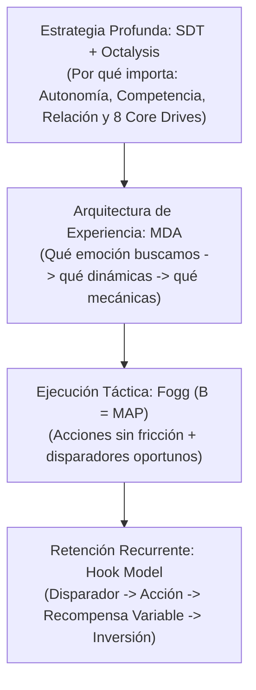

# Análisis Profundo de Gamificación y Casos de Éxito

Documento de investigación aplicada orientado a extraer **marcos teóricos avanzados**, **mecánicas probadas en la industria** y **patrones replicables** para diseñar una plataforma gamificada de gestión de actividades individuales y en equipo (con foco en avance visual, hábitos recurrentes y colaboración).

## Tabla de Contenidos

1. [Ecosistema de Marcos Teóricos (Más allá de PBL)](#1-ecosistema-de-marcos-teóricos-más-allá-de-pbl)
2. [Casos de Éxito de Referencia en la Industria](#2-casos-de-éxito-de-referencia-en-la-industria)
3. [Tabla Comparativa de Mecánicas y Resultados](#3-tabla-comparativa-de-mecánicas-y-resultados)
4. [Qué Copiar y Qué Evitar en Nuestro Proyecto](#4-qué-copiar-y-qué-evitar-en-nuestro-proyecto)
5. [Blueprint de Mecánicas Recomendadas por Caso de Uso](#5-blueprint-de-mecánicas-recomendadas-por-caso-de-uso)

---

## 1. Ecosistema de Marcos Teóricos (Más allá de PBL)

La gamificación superficial falla cuando solo añade **PBL** (*Points, Badges, Leaderboards*) sobre un sistema aburrido. Los productos más exitosos combinan cinco marcos complementarios según la capa de diseño:

### 1.1 Teoría de la Autodeterminación — SDT (Deci & Ryan)
Explica qué sostiene la **motivación intrínseca** a largo plazo. Un sistema logra compromiso duradero cuando satisface tres necesidades psicológicas básicas:
- **Autonomía:** Sentir que uno elige sus metas, prioridades o forma de avanzar (no sentirse controlado por el sistema).
- **Competencia (Maestría):** Sentir que se progresa, se superan retos acordes al nivel y se domina una habilidad.
- **Relación (*Relatedness*):** Sentir conexión, pertenencia o aporte hacia otras personas o un equipo.

### 1.2 Marco MDA (*Mechanics, Dynamics, Aesthetics* — Hunicke, LeBlanc, Zubek)
Formaliza cómo diseñar de forma inversa (**de la emoción a la regla**):
1. **Aesthetics (Estética / Emoción deseada):** Qué debe *sentir* el usuario (ej. progreso, descubrimiento, camaradería, desafío).
2. **Dynamics (Dinámicas):** Qué comportamientos emergen en tiempo de ejecución para producir esa emoción.
3. **Mechanics (Mecánicas):** Qué reglas, acciones y estructuras de datos se programan para generar esas dinámicas.

### 1.3 Modelo de Comportamiento de Fogg ($B = MAP$)
Para que una acción puntual ocurra, deben converger tres elementos en el mismo instante:
$$\text{Comportamiento} = \text{Motivación} \times \text{Habilidad (Facilidad)} \times \text{Disparador (Prompt)}$$
- Si el usuario no completa actividades en tu plataforma, el fallo casi siempre está en una fricción alta (**baja habilidad/facilidad**, ej. demasiados clics para registrar una tarea) o en un **disparador** mal ubicado, no solo en falta de motivación.

### 1.4 Hook Model (Nir Eyal) — Bucle de Hábitos
Explica cómo transformar una herramienta de uso ocasional en un hábito recurrente en cuatro fases:
1. **Disparador (*Trigger*):** Externo (notificación, recordatorio) → Interno (deseo de mantener el progreso o cerrar el día en orden).
2. **Acción:** El comportamiento mínimo más simple posible en anticipación de recompensa (ej. marcar una tarea completada).
3. **Recompensa Variable:** Retroalimentación visual/emocional no siempre idéntica (cofres, mensajes, multiplicadores, logros sorpresa).
4. **Inversión:** Capital que el usuario deja dentro del sistema (historial visual, racha acumulada, proyectos compartidos), aumentando el valor de volver mañana.

### 1.5 Cómo se Integran los Marcos

---

## 2. Casos de Éxito de Referencia en la Industria

### 2.1 Duolingo — El Estándar de Retención Diaria
Duolingo entendió que su competidor principal no eran otros cursos, sino el abandono por falta de constancia (*"lograr que el usuario vuelva mañana"*).

- **Mecánicas clave:**
  - **Rachas (*Streaks*) con salvavidas humanos:** Contador de días consecutivos al frente de la interfaz. Para evitar que perder una racha de 50 días provoque abandono definitivo por frustración, introdujeron **Streak Freezes** (protectores comprados con moneda virtual) y **Streak Repairs**.
  - **Friend Streaks:** Rachas compartidas entre dos amigos para crear responsabilidad social mutua.
  - **XP inmediato + Ligas dinámicas por cohorte:** Puntos inmediatos al terminar cada micro-sesión y ligas semanales (Bronce a Diamante) donde compites solo contra usuarios con un nivel de actividad similar al tuyo, evitando rankings globales inalcanzables.
  - **Narrativa emocional (Duo):** Mascota con personalidad que refuerza la conexión afectiva y los recordatorios.
- **Resultado:** Escalamiento a decenas de millones de usuarios activos diarios (DAU), fuerte reducción del abandono temprano entre el día 1 y el día 30, y monetización impulsada por la urgencia gamificada.

### 2.2 Habitica — Productividad como RPG Completo
Convierte hábitos, tareas diarias y listas *to-do* en un juego de rol retro.

- **Mecánicas clave:**
  - **Progresión de personaje:** Completar tareas otorga XP, oro, niveles, equipamiento y mascotas.
  - **Equipos y Misiones (*Parties & Quests*):** Grupos de usuarios que combaten jefes sumando el cumplimiento de sus tareas reales.
  - **Refuerzo negativo (HP):** Si fallas una tarea diaria, pierdes puntos de vida (HP); en misiones grupales, el incumplimiento de uno daña al grupo entero.
- **Lección crítica (qué evitar):** Funciona muy bien para amantes de los RPG y quienes buscan presión social fuerte, pero la sobrecarga de gestión y el castigo punitivo pueden convertir la herramienta de productividad en una carga administrativa estresante.

### 2.3 Todoist Karma — Gamificación Ligera para Profesionales
Integra una capa sutil y analítica sobre un gestor de tareas profesional sin elementos fantásticos.

- **Mecánicas clave:**
  - **Puntos y Niveles de Karma:** Sumas puntos al completar tareas a tiempo y cumplir metas diarias/semanales; pierdes puntos si acumulas tareas vencidas.
  - **Gráficas visuales de velocidad y rachas:** Visualización clara del ritmo diario/semanal por colores según tipo de proyecto.
- **Lección crítica (qué evitar):** Cuando los puntos dependen únicamente de *cantidad* de tareas cerradas, los usuarios tienden a "hackear" el sistema dividiendo una tarea trivial en diez subtareas para inflar su puntaje.

### 2.4 Forest — Metáfora Visual Viva y Desintoxicación Digital
Aplica la técnica Pomodoro envuelta en una metáfora emocional de crecimiento.

- **Mecánicas clave:**
  - **Crecimiento visual y gratificación diferida:** Al iniciar una sesión de enfoque plantas una semilla que crece en un árbol al terminar el tiempo.
  - **Penalización visual directa:** Abandonar la app antes de tiempo marchita el árbol en tu bosque.
  - **Impacto real:** Monedas virtuales acumuladas pueden canjearse para plantar árboles reales mediante organizaciones aliadas.
- **Lección clave:** Convertir el progreso acumulado en un **artefacto visual coleccionable** (un bosque que refleja tus horas de trabajo) genera apego emocional sin necesidad de textos complejos.

### 2.5 GitHub Contribution Graph — Consistencia por Mapa de Calor
Aunque no se vende como "juego", su cuadrícula de contribuciones anuales es una de las mecánicas visuales más influyentes del software.

- **Mecánicas clave:**
  - **Heatmap anual por intensidad:** Cuadrados con gradientes de color según la densidad de trabajo diario (más actividad = verde más intenso).
  - **Cadena continua y portafolio visible:** Ver una cadena de días activos motiva a "no romper el patrón" y sirve como evidencia objetiva de constancia.
- **Lección clave:** Un mapa de calor diario resuelve de un vistazo el requisito de *"mostrar el cumplimiento de forma visual"* mejor que una lista larga de registros.

### 2.6 Asana — Micro-interacciones Celebratorias en Equipos
Demuestra cómo gamificar gestión de proyectos empresariales sin distraer del trabajo.

- **Mecánicas clave:**
  - **Barras de progreso por proyecto e hitos:** Claridad instantánea de cuánto falta para cerrar un objetivo de equipo.
  - **Celebraciones sorpresa:** Al marcar tareas completadas, ocasionalmente aparecen animaciones breves (criaturas voladoras) que inyectan un micro-estímulo positivo (*recompensa variable ligera*) y reducen la sensación de trabajo interminable.

### 2.7 Strava y Nike Run Club (NRC) — Competencia Justa y Metas Tempranas
- **Strava (Competencia descentralizada):** En vez de un ranking global imposible donde siempre ganan los mismos, divide el mundo en **Segmentos** locales y otorga títulos de **Local Legend** basados en **constancia** (quien más veces recorre un tramo, no necesariamente el más rápido). Más del **72% de las metas** de carrera fijadas en Strava se completan.
- **Nike Run Club (Logros tempranos + superación propia):** Combina competir contra tus propias marcas previas con insignias escalonadas desde el primer uso. Más del **43% de los desbloqueos personalizados** ocurren el primer día, y sus funciones gamificadas generaron un **+21% en retención de usuarios**.

### 2.8 Otros Referentes Notables
- **Starbucks Rewards:** Combina niveles (*Stars*), retos personalizados (*"prueba X esta semana por bono"*) y ventanas de urgencia (*Double Star Days*). Alcanzó **35.5 millones de miembros activos** (90 días en EE. UU.), aportando **cerca del 60% de los ingresos** en tiendas operadas en EE. UU., con miembros gastando **2.5x a 3x más**.
- **Salesforce Trailhead:** Transforma capacitación técnica compleja en rutas de aprendizaje (*Trails*), insignias visuales y rangos (*Mountaineer*, *Ranger*).
- **Foldit:** Convirtió el plegamiento de proteínas en un puzzle 3D colaborativo con creación de estrategias compartidas (*recipes*), logrando que jugadores resolvieran en **3 semanas** la estructura de una enzima vinculada al VIH que había frenado a investigadores durante más de una década.

---

## 3. Tabla Comparativa de Mecánicas y Resultados

| Plataforma | Dominio | Mecánica Estrella | Visualización de Progreso | Core Drives Dominantes (Octalysis) | Riesgo / Lección Aprendida |
| :--- | :--- | :--- | :--- | :--- | :--- |
| **Duolingo** | Aprendizaje | Rachas + *Streak Freeze* + Ligas por cohorte | Llama diaria, barra de XP, tabla semanal | CD2, CD5, CD8 | Sin salva-rachas, romper una racha larga causa abandono |
| **Habitica** | Hábitos / Tareas | RPG (XP, Oro, HP) + Jefes de equipo | Barras de vida/XP y avatar | CD2, CD4, CD5, CD8 | Castigo fuerte y exceso de configuración abruma |
| **Todoist Karma** | Tareas Pro | Puntos por puntualidad y metas semanales | Gráficas de barras/tendencia + niveles | CD2, CD4 | Contar tareas sin peso incentiva dividir en micro-tareas falsas |
| **Forest** | Foco / Tiempo | Temporizador con crecimiento/muerte visual | Bosque acumulado día a día | CD1, CD4, CD8 | Es solo foco; no gestiona proyectos ni dependencias |
| **GitHub** | Desarrollo | Registro diario continuo | *Heatmap* anual por intensidad | CD2, CD4 | Incentiva "actividad cosmética" si se mide solo volumen |
| **Asana** | Proyectos Equipo | Hitos + micro-animaciones sorpresa | Barras de proyecto e indicadores de estado | CD2, CD3, CD7 | Debe ser sutil para no estorbar el flujo de trabajo |
| **Strava** | Deporte / Social | Segmentos locales + *Local Legends* (constancia) | Mapas, trofeos, gráficas de esfuerzo | CD2, CD5 | Rankings globales desmotivan; los segmentos pequeños incluyen a todos |
| **NRC** | Deporte Personal | Hitos tempranos (Día 1) + récords propios | Medallas por hito y récords personales | CD2, CD3 | Dar una victoria rápida en el Día 1 dispara la retención (+21%) |

---

## 4. Qué Copiar y Qué Evitar en Nuestro Proyecto

Pensando directamente en una **plataforma gamificada de organización y cumplimiento de actividades (individuales y en equipo) con reportes gráficos**:

### Qué SÍ Copiar (Buenas Prácticas)
1. **Victoria temprana en los primeros minutos (estilo NRC):** Que el usuario gane su primer hito o insignia el mismo día que crea su proyecto o completa su primera actividad (reduce la fricción inicial).
2. **Rachas con "Escudo / Freeze" (estilo Duolingo):** Premiar la constancia en actividades recurrentes, pero ofrecer días de descanso configurables o "escudos de racha" ganados con puntos para no destruir la motivación por un imprevisto.
3. **Progreso visual multicapa (estilo GitHub + Asana + Todoist):**
   - *Heatmap* de actividad diaria (constancia de un vistazo).
   - Barras de avance por proyecto e hitos (estado actual).
   - Gráficas comparativas de cumplimiento por usuario/acción (reporte analítico).
4. **Premiar la constancia además de la velocidad (estilo Strava *Local Legend*):** En equipos, no solo destacar al que hace más puntos totales, sino reconocer consistencia semanal o cumplimiento de actividades recurrentes.
5. **Micro-recompensas visuales y feedback inmediato (estilo Asana + Duolingo):** Animación limpia, sonido opcional o incremento animado de barra/XP en el instante exacto en que se marca una acción completada.
6. **Metas cooperativas de proyecto (estilo Habitica sin castigo tóxico):** Que las actividades completadas por cada miembro aporten a una barra o meta común del proyecto (ej. completar el *sprint* o alcanzar un hito grupal).

### Qué EVITAR (Antipatrones)
1. **Puntuación plana vulnerable a trampas (error clásico de Todoist):** Si cada tarea vale igual sin importar complejidad o recurrencia, el usuario puede crear 20 tareas triviales para farmear XP. *Solución:* ponderar por prioridad/dificultad o limitar XP diario de tareas rápidas.
2. **Castigos punitivos que dañen al equipo (error de Habitica en entornos reales):** Que el retraso de un usuario reste puntos o "mate" el progreso de sus compañeros genera fricción social y rechazo en equipos de trabajo/estudio.
3. **Rankings globales absolutos (error evitado por Strava y Duolingo):** Un ranking único donde los usuarios antiguos tienen 10,000 puntos desmotiva de inmediato a los nuevos. *Solución:* rankings **por proyecto**, **por semana** o centrados en el **progreso personal**.
4. **Dependencia exclusiva de *Black Hat* (escasez/miedo):** No convertir la app en una máquina de ansiedad por penalizaciones; priorizar *White Hat* (claridad de logro, autonomía, propósito del proyecto, colaboración).

---

## 5. Blueprint de Mecánicas Recomendadas por Caso de Uso

Mapeo directo sobre los 4 casos de uso obligatorios del proyecto (`PRACTICO.pdf`):

| Caso de Uso del Proyecto | Mecánica Recomendada (Inspiración) | Visualización Gráfica Sugerida | Core Drive / Bartle |
| :--- | :--- | :--- | :--- |
| **1. Registro e inicio de sesión** | *Onboarding* con meta diaria/semanal elegida por el usuario + insignia "Primer Paso" al completar perfil/primera acción (NRC). | Barra de configuración inicial / nivel 1 desbloqueado. | **CD2, CD3** (Autonomía) · Todos los perfiles |
| **2. Actividades únicas y recurrentes** | XP diferenciado por tipo/prioridad; **racha de días** para recurrentes + "escudo protector" acumulable (Duolingo); micro-celebración al completar (Asana). | **Heatmap de constancia** estilo GitHub + contador de racha activa y escudos. | **CD2, CD4, CD8 (balanceado)** · Triunfadores y Exploradores |
| **3. Gestión de proyectos y vinculación de usuarios** | Meta grupal de proyecto (progreso compartido sin castigo); roles/aportes visibles; reconocimiento semanal por constancia dentro del proyecto (Strava). | Barra de avance del proyecto + desglose de contribución por miembro vinculado. | **CD1, CD5** · Socializadores y Triunfadores |
| **4. Reporte gráfico de progreso por acción** | Tablero analítico que transforma el historial de acciones en indicadores de desempeño individual y grupal (Todoist Karma + GitHub). | Gráficas de cumplimiento (únicas vs. recurrentes), tendencia semanal, heatmap y ranking interno opcional del proyecto. | **CD2, CD3** · Triunfadores y Competidores sanos |

