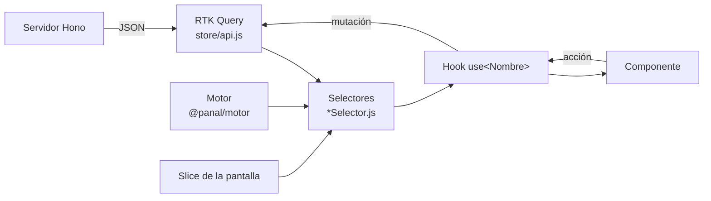

# Guía de frontend

Cómo está hecha `apps/web` y cómo se agrega algo sin romper su orden. Las razones del stack están en [`../proyecto/04-stack-y-arquitectura.md`](../proyecto/04-stack-y-arquitectura.md); qué muestra cada pantalla, en [`../proyecto/03-pantallas.md`](../proyecto/03-pantallas.md).

## Tabla de contenidos

1. [Mapa de carpetas](#1-mapa-de-carpetas)
2. [El recorrido de un dato](#2-el-recorrido-de-un-dato)
3. [El store](#3-el-store)
4. [Una funcionalidad por dentro](#4-una-funcionalidad-por-dentro)
5. [Rutas y ventanas](#5-rutas-y-ventanas)
6. [Formularios](#6-formularios)
7. [Efectos: avisos, celebraciones y lo que se recuerda](#7-efectos-avisos-celebraciones-y-lo-que-se-recuerda)
8. [Estilos](#8-estilos)
9. [PWA: instalar y abrir sin red](#9-pwa-instalar-y-abrir-sin-red)
10. [Agregar una pantalla, paso a paso](#10-agregar-una-pantalla-paso-a-paso)

## 1. Mapa de carpetas

```
apps/web/
├── pwa/                # sw.js, complemento.js, registro.js y sus pruebas (sección 9)
├── public/             # manifiesto, iconos y favicon
└── src/
    ├── main.jsx        # monta Provider, BrowserRouter y App; importa fuentes y estilos globales
    ├── store/          # REDUX: el store y la caché del servidor (sección 3)
    │   ├── index.js    # crearStore(): RTK Query + un slice por carpeta de nucleo/ y feature/
    │   ├── api.js      # RTK Query: cada ruta de la API, sus etiquetas, las mutaciones optimistas y los selectores de datos
    │   └── errores.js  # leerError(): cualquier fallo → { codigo, mensaje, campos }; mensajeGeneral()
    ├── nucleo/         # estado y reglas que comparten varias pantallas, con la forma de una funcionalidad
    │   ├── cuenta/     # quién entró, salir, la invitación pendiente
    │   ├── panal/      # el día de hoy: racha, gotas, oficio, Zum, constancia; llenar y archivar celdas
    │   ├── reloj/      # la hora; al cruzar las 03:00 vuelve a pedir el día
    │   ├── avisos/  celebraciones/  conexion/  preferencias/
    │   └── textos.js   # textos de dominio: fechas de una celda, reglas, racha
    ├── feature/<nombre>/  # una carpeta por pantalla (sección 4)
    ├── componentes/
    │   ├── ui/         # piezas genéricas: Boton, Ventana, Formulario, Estados, Tarjeta…
    │   └── panal/      # dibujos del dominio: Zum, PanalDeHoy, RejillaDeColmena, SelloDeCera…
    ├── lib/            # utilidades sin React ni Redux: almacen, formato, anunciar, clases, dispositivo
    ├── app/            # App.jsx (las rutas), Estructura.jsx (cabecera, navegación, franjas) y reglas.test.js
    ├── estilos/        # tokens.css (variables) y base.css (lo global)
    └── assets/zum/     # los seis estados de Zum en WebP, copiados de assets-fuente/listos
```

Las dependencias van en un solo sentido: `feature` → `nucleo` → `store` → `lib`, y `componentes/panal` → `componentes/ui` → `lib`. Una pantalla no importa de otra; lo que comparten sube a `nucleo/` (estado y reglas) o a `componentes/` (lo que se ve).

| Carpeta | Pantalla | Qué guarda su slice |
| :--- | :--- | :--- |
| `feature/sesion` | P01 Entrar, P02 Crear, guardias | Nada |
| `feature/primerVuelo` | P03 | El paso del recorrido (localStorage) |
| `feature/hoy` | P04 | El día en que se cerró la franja de racha (localStorage) |
| `feature/celdas` | P05 | Los filtros. La pestaña va en la dirección |
| `feature/actividad` | P06 | Los borradores del formulario |
| `feature/colmenas` | P07, P08, P09 | La pestaña del detalle |
| `feature/unirme` | P13 | Nada: la invitación pendiente es de `nucleo/cuenta` |
| `feature/reportes` | P10 | El periodo |
| `feature/miVuelo` | P11 | El sello abierto |
| `feature/errores` | P14 | Nada: solo pantallas |
| `nucleo/cuenta` | Todas | La invitación pendiente (sessionStorage) |
| `nucleo/celebraciones` | P12 | La cola de logros |
| `nucleo/avisos` | Todas | La cola de avisos |
| `nucleo/conexion` | Todas | Si hay red, si se puede instalar y si hay una versión nueva |
| `nucleo/preferencias` | Todas | Reducir animaciones (localStorage) |
| `nucleo/reloj` | Todas | La hora, para que ningún selector lea el reloj |
| `nucleo/panal` | Hoy, Celdas, Colmenas, Mi vuelo | Nada: solo selectores y hooks sobre la caché |

## 2. El recorrido de un dato



- **El servidor manda hechos; el cliente calcula.** `GET /api/panal` trae actividades, celdas llenas y `progreso` hasta ayer. La racha, las gotas de hoy, el oficio y el estado de Zum los calculan los selectores con el motor (`avanzarDia`, `rachaParaHoy`, `gotasDelVuelo`, `estadoDeZum`). Así la pantalla responde al instante y el servidor no guarda lo que se puede deducir.
- **El motor no lee el reloj.** "Hoy" llega del servidor (`panal.hoy`) y la hora, del slice `reloj`.
- **Los ajustes viajan con su historial.** `GET /api/panal` trae `tramosDeAjustes`; `nucleo/panal/panalSelector.js` los pasa al motor como `historial`, y el panal de constancia dibuja cada día con la meta de entonces.
- **Llenar o vaciar una celda** se hace siempre con `useAlternarCelda()` (`nucleo/panal/useCelda.js`), desde Hoy, Celdas o una colmena: ignora un segundo toque mientras el primero viaja, avisa si falla y encola las celebraciones si sale bien.
- **Los componentes muestran lo que reciben.** Nada de `.filter` ni cuentas en un JSX: eso va en un selector memorizado (`createSelector`).

## 3. El store

Todo Redux está en `store/` y en los `*Slice.js`. `store/index.js` monta `api` (RTK Query) y un slice por carpeta de `nucleo/` y `feature/`. Tres reglas:

1. **Lo que es verdad en el servidor vive en el caché de RTK Query**, nunca copiado en un slice. Todas las rutas están en un solo `store/api.js` porque las etiquetas (`Yo`, `Panal`, `Actividades`, `Colmenas`, `Invitacion`, `Progreso`, `Reporte`) las atan: llenar una celda vuelve a pedir el panal, la colmena y el progreso. Los selectores leen el caché con `selectYo`, `selectPanal`, `selectActividades`… del mismo archivo.
2. **Lo que solo existe en la pantalla vive en el slice de su funcionalidad**: filtros, pestañas, borradores, colas.
3. **Un efecto vive junto a lo que lo provoca** (sección 7): en el hook que llama a la mutación o en un thunk del slice. No hay middleware de escuchas.

Mutaciones optimistas: `llenarCelda` y `vaciarCelda` cambian el caché de `obtenerPanal` y de `obtenerColmena` antes de que responda el servidor y lo deshacen si falla (`onQueryStarted` con `updateQueryData` y `patch.undo()`). La celda nueva lleva un `id` creado en el navegador (`crypto.randomUUID()`), de modo que repetir el envío no crea dos.

## 4. Una funcionalidad por dentro

Es la estructura del ejemplo del docente y un requisito de la materia:

| Archivo | Responsabilidad |
| :--- | :--- |
| `<nombre>Slice.js` | Estado de la pantalla y sus acciones. `initialState` como función si lee el navegador |
| `<nombre>Selector.js` | Todo valor calculado, memorizado. Combina caché, slice y motor |
| `use<Nombre>.js` | El único punto de contacto del componente: consultas, selectores y acciones |
| `<Pantalla>.jsx` | Lo que se ve. Recibe datos listos y llama funciones del hook |
| `textos.js` | Cada texto de la interfaz, con sus funciones de plural y fecha |
| `<Pantalla>.module.css` | Sus estilos, con las variables de `tokens.css` |

Los textos de dominio compartidos (`textoDeRegla`, `detalleDeActividad`, la racha) están en `nucleo/textos.js`; plurales y fechas, en `lib/formato.js`. Una pantalla no importa nada de otra: si dos necesitan el mismo estado o la misma regla, sube a `nucleo/`; si necesitan la misma pieza visual, a `componentes/`.

## 5. Rutas y ventanas

`App.jsx` tiene dos `Routes`:

- El primero dibuja la pantalla de fondo con `location={state.fondo ?? ubicacion}`.
- El segundo dibuja solo las ventanas con ruta propia: P06 (`/celdas/nueva`, `/celdas/:id`) y P09 (`/colmenas/:id/invitar`).

Quien abre una ventana usa `<Boton a="/celdas/nueva" ventana>` o `<EnlaceAVentana to=…>`: llevan la ubicación actual como `fondo`. Para cerrarla, `salir(destino)` de `useFondo()`: vuelve con `navigate(-1)` si hay fondo o va a `destino`, la pantalla madre, si se abrió con un enlace directo. Así funcionan el botón Atrás del teléfono y los enlaces compartidos. Las ventanas con ruta se declaran una vez, en la lista `VENTANAS` de `App.jsx`.

Las guardias de `feature/sesion/Guardias.jsx` reparten las zonas: `SinSesion` (entrar, crear), `ConSesion` (primer vuelo y aplicación) y `SoloConSesion`, una ruta de layout que envuelve las tres ventanas.

**Carga bajo demanda.** Hoy va en el archivo principal; las demás pantallas se declaran con `perezosa(() => import(...), "Nombre")` y llegan la primera vez que se visitan. Mientras tanto, `Estructura` muestra una `Silueta`; si la descarga falla, `LimiteDeError` pone "Reintentar" en el lugar de la pantalla y la navegación sigue en pie. Una pantalla nueva se agrega igual. El service worker guarda todos los archivos al instalarse, así que también abren sin red.

`componentes/ui/Ventana.jsx` envuelve el `<dialog>` nativo con `showModal()`: foco atrapado, Escape, capa superior y fondo inerte vienen del navegador. Sus opciones:

| Opción | Para qué |
| :--- | :--- |
| `cerrarAlTocarFuera` | Menús y avisos de solo lectura. Usa `closedby="any"` y un respaldo para Safari |
| `antesDeCerrar(evento)` | Preguntar antes de descartar cambios: `evento.preventDefault()` |
| `tamano="completa"` | Formularios largos: pantalla completa en teléfono |
| `pie` | Botones fijos abajo, fuera del desplazamiento |

Dentro de una ventana, `useCerrarVentana()` la cierra; el evento `close` llama a `alCerrar`, que desmonta la ventana o navega.

## 6. Formularios

`componentes/ui/useFormulario.js` + los campos de `componentes/ui/Formulario.jsx` + un esquema de `@panal/contratos`, el mismo que valida el servidor.

- `noValidate` en el `<form>`: los mensajes son los de Zod, en español.
- Se valida al salir de un campo tocado; un error desaparece en cuanto el valor es válido.
- Al enviar con errores, el foco va al primer campo inválido.
- `convertir` transforma los campos (cómodos de editar) a la forma del contrato antes de validar.
- `mostrarErroresDelServidor(leerError(resultado.error).campos)` pinta los errores `datos_invalidos` junto a su campo, y `mensajeGeneral(error)` da lo que va arriba del formulario: cualquier otro error, sin repetir los de los campos.
- Lo escrito en P06 se guarda como borrador en el slice `actividad`: no se pierde si la ventana se cierra o el guardado falla.

## 7. Efectos: avisos, celebraciones y lo que se recuerda

Cada efecto vive junto a lo que lo provoca:

| Efecto | Dónde |
| :--- | :--- |
| Llenar una celda encola sus celebraciones; si falla, un aviso explica que volvió a como estaba | `useAlternarCelda()` en `nucleo/panal/useCelda.js`. El primer vuelo no la usa, así que no celebra |
| Cruzar las 03:00 invalida `Panal`, `Actividades`, `Colmenas`, `Progreso` y `Reporte` | El thunk `ponerEnHora` de `nucleo/reloj/relojSlice.js` |
| La invitación pendiente, la franja cerrada, el primer vuelo y el movimiento se guardan en el navegador | Cada slice declara su `recuerdo(clave, de, donde)`; `store/index.js` los pasa a `recordarEnElNavegador` (`lib/almacen.js`), que guarda o borra cuando el valor cambia. El slice lo lee al iniciar con `recuerdo.leido()` |

Para avisar desde un hook: `const avisar = useAvisar(); avisar({ texto, tono, accion })`. Una `accion` con `mutacion` y `argumentos` ofrece "Deshacer" sin escribir otro código. Para el caso común de avisar según el resultado de una mutación, `useAvisarResultado()(resultado, { exito, error })` devuelve si salió bien. Las celebraciones las dibuja `Celebracion.jsx` cuando la cola tiene logros.

## 8. Estilos

- **CSS Modules** con las variables de `estilos/tokens.css`. Un color, radio, sombra o fuente nuevo es primero una variable.
- **Las piezas miran su contenedor** (`container-type` y `@container`); solo `Estructura.module.css` mira el ancho de la ventana.
- **Estados con atributos**: `data-llena`, `data-tono`, `aria-current`, `[open]`. El JSX no arma nombres de clase condicionales.
- **Variables para el tamaño de una pieza**: una pieza que acepta `className` expone su tamaño como variable (`--tamano-zum`). Si quien la usa escribe `inline-size`, las dos reglas empatan en especificidad y gana el orden de carga del CSS, que no es fijo.
- **Movimiento solo con permiso**: las animaciones van dentro de `@media (prefers-reduced-motion: no-preference)`. "Reducir animaciones" de Mi vuelo pone `data-movimiento="reducido"` en `<html>` y `base.css` las apaga.

## 9. PWA: instalar y abrir sin red

Lo que entra en la versión 1 está en [D7 de `04-stack-y-arquitectura.md`](../proyecto/04-stack-y-arquitectura.md#d7-pwa-qué-entra-y-qué-no). Todo vive en `apps/web/pwa/`, un archivo por tarea:

| Archivo | Corre en | Qué hace |
| :--- | :--- | :--- |
| `sw.js` | El service worker | La aplicación se sirve desde el caché; los `GET /api/*` van primero a la red y se guardan en `panal-datos`; una navegación sin red recibe la página guardada. Escribir siempre pide red. Una versión nueva espera el mensaje `"actualizar"` |
| `complemento.js` | Node, al compilar | Publica `sw.js` con `self.__PANAL__ = { version, precarga }`: los JS, CSS y fuentes latinas de esa compilación, más lo que el `index.html` enlaza en su `<head>` (favicon, manifiesto, icono de Apple). La versión sale de esos nombres, que llevan la huella del contenido |
| `registro.js` | La página | Registra el service worker (solo en producción), avisa de una versión nueva y la activa, escucha la oferta de instalación e instala: `navigator.install()` si existe; si no, `beforeinstallprompt`, que sirve una sola vez. No sabe de React |
| `sw.test.js` | Las pruebas | Evalúa `sw.js` tal como se publica, con `caches` y `fetch` de mentira, y prueba el complemento |

`nucleo/conexion/useConexion.js` solo conecta `registro.js` con el slice `conexion`: `FranjaDeVersion` ofrece "Actualizar" y Mi vuelo, "Instalar", cuando hay cómo. Al cerrar sesión se borra `panal-datos`: lo guardado era de esa cuenta.

**Cambiar una estrategia de caché**: primero la prueba en `sw.test.js`, después `sw.js`. `vp run test` lo comprueba en milisegundos.

**Verla en el navegador**: `vp run preview`, con `vp run dev` apagado. Compila la web y la sirve en <http://localhost:4173> junto a la API. En desarrollo no hay service worker. Para borrarlo después: DevTools, Application, Service workers, Unregister, y Storage, Clear site data.

## 10. Agregar una pantalla, paso a paso

1. Leer su ficha en [`03-pantallas.md`](../proyecto/03-pantallas.md) y su diseño de referencia.
2. Si necesita datos nuevos, agregar el endpoint en `store/api.js` con sus etiquetas y su selector de datos, y la ruta en el servidor (ver [`backend.md`](backend.md)).
3. Crear `feature/<nombre>/` con slice, selector, hook, componente, `textos.js` y estilos. Registrar el slice en `store/index.js`.
4. Declarar la pantalla con `perezosa(...)` y agregar su ruta en `app/App.jsx` (si es una ventana, en la lista `VENTANAS`).
5. Resolver los siete estados de [`ux-ui.md`](ux-ui.md#2-estados-que-toda-pantalla-resuelve).
6. Comprobar: `vp run check`, `vp run test`, `vp run build` y el navegador a 1366 y 390 px sin errores en la consola.
