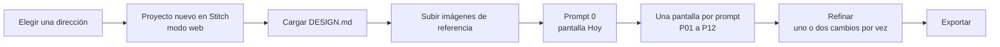

# Guía para llevar las propuestas a Stitch

Stitch (stitch.google.com) es la herramienta de Google Labs que genera interfaces a partir de texto, imágenes de referencia y un sistema de diseño. Esta guía explica cómo usar los tres archivos que tiene cada carpeta de dirección:

| Archivo | Para qué sirve en Stitch |
| :--- | :--- |
| `DESIGN.md` | Sistema de diseño: colores, tipografías, formas y componentes. Mantiene iguales todas las pantallas |
| `prompts-stitch.md` | Los textos listos para copiar: uno para arrancar el proyecto y uno por pantalla |
| `referencia/` | Capturas del tablero y de la mascota para subir como imagen de referencia |

## Tabla de contenidos

1. [Flujo de trabajo](#1-flujo-de-trabajo)
2. [Cómo cargar el DESIGN.md](#2-cómo-cargar-el-designmd)
3. [Reglas para escribirle a Stitch](#3-reglas-para-escribirle-a-stitch)
4. [Anatomía de los prompts de este proyecto](#4-anatomía-de-los-prompts-de-este-proyecto)
5. [La mascota: qué esperar y cómo resolverla](#5-la-mascota-qué-esperar-y-cómo-resolverla)
6. [Prompts de corrección](#6-prompts-de-corrección)
7. [Lista de control por pantalla](#7-lista-de-control-por-pantalla)
8. [Validar un DESIGN.md](#8-validar-un-designmd)
9. [Lo que no pude verificar](#9-lo-que-no-pude-verificar)
10. [Fuentes](#10-fuentes)

---

## 1. Flujo de trabajo



1. **Elige una dirección** y abre su carpeta. Conviene probar primero dos direcciones solo con la pantalla "Hoy" antes de generar las doce pantallas de una.
2. **Crea un proyecto nuevo** en modo web (escritorio). La plataforma es web y los tableros se diseñaron a 1360 px de ancho.
3. **Carga el `DESIGN.md`** de la dirección (sección 2).
4. **Sube las imágenes** de `referencia/`: la captura de la pantalla "Hoy" y la mascota.
5. **Envía el Prompt 0.** Genera la pantalla "Hoy", que es el ancla visual de todo lo demás. No avances hasta que esta pantalla te convenza.
6. **Genera el resto**, una pantalla por prompt, en el orden del archivo. Cada prompt pide mantener el estilo de "Hoy".
7. **Refina** con cambios pequeños (sección 6).
8. **Exporta** cuando el conjunto sea coherente y guarda los resultados en una carpeta `disenos-stitch/` dentro de la dirección.

## 2. Cómo cargar el DESIGN.md

`DESIGN.md` es un formato abierto de Google Labs: un bloque de tokens en YAML (valores exactos) seguido de secciones en Markdown que explican cómo aplicarlos. Stitch lo usa para que lo que genera respete la marca, y permite importar y exportar estas reglas entre proyectos.

Hay dos caminos:

- **Importarlo.** Busca en el proyecto la opción del sistema de diseño o tema e importa el archivo. Es el camino preferido.
- **Pegarlo.** Si no encuentras la opción, abre el archivo, copia todo su contenido y envíalo como primer mensaje con esta frase delante:

```text
Este es el sistema de diseño del proyecto en formato DESIGN.md. Úsalo como única fuente de colores, tipografías, radios, espaciados y componentes para todas las pantallas que te pida. No inventes colores ni fuentes fuera de él.
```

Los encabezados de las secciones del `DESIGN.md` están en inglés porque así los exige la especificación (`Overview`, `Colors`, `Typography`, `Layout`, `Elevation & Depth`, `Shapes`, `Components`, `Do's and Don'ts`). El contenido está en español.

## 3. Reglas para escribirle a Stitch

Tomadas de la guía de prompts de Stitch y aplicadas en todos los archivos `prompts-stitch.md`:

| Regla | Aplicación |
| :--- | :--- |
| Una pantalla o componente por prompt | Cada prompt genera una sola pantalla |
| Ser específico: qué cambiar y cómo debe verse | Los textos de la interfaz van escritos tal cual, entre comillas |
| Uno o dos ajustes por prompt al refinar | Los refinamientos van separados, nunca en bloque |
| Usar términos de interfaz | Barra de navegación, tarjeta, botón principal, pestañas, ventana modal |
| Describir la posición | Izquierda, centro, derecha; arriba, abajo |
| Fijar el ambiente con adjetivos | Cada Prompt 0 abre con tres o cuatro adjetivos del mundo |
| Nombrar los elementos por su contenido | "La tarjeta Actividades de hoy", no "la segunda tarjeta" |
| Decir si imágenes e iconos deben seguir el tema | Incluido en cada Prompt 0 |

Dos decisiones propias:

- **Los prompts están en español** para que la interfaz salga en español desde el primer intento. Si alguna pantalla sale en inglés, usa el prompt de corrección de idioma.
- **Los prompts son más largos que un mensaje casual** porque llevan el texto exacto de la interfaz. Si Stitch omite una parte, no repitas todo: pide solo lo que faltó en un segundo mensaje.

## 4. Anatomía de los prompts de este proyecto

Todos los prompts de pantalla siguen el mismo orden. Sirve para escribir los tuyos cuando agregues pantallas.

```text
[Qué pantalla es y para qué sirve, en una frase.]
[Estructura: qué hay arriba, a la izquierda, al centro, a la derecha y abajo.]
[Contenido: los textos exactos entre comillas y los datos de ejemplo.]
[Elemento del mundo: cómo aparece la mascota o la gráfica propia de la dirección.]
[Restricciones: mismo estilo que la pantalla Hoy, sin degradados, sin emojis, contraste alto.]
```

Datos de ejemplo comunes a las cinco direcciones (así se pueden comparar):

| Dato | Valor |
| :--- | :--- |
| Persona | Ana |
| Fecha | Viernes 13 de noviembre |
| Progreso de hoy | 3 de 5 |
| Puntos de hoy | 45 |
| Puntos totales y nivel | 640, nivel 4, faltan 60 para el nivel 5 |
| Racha y protectores | 12 días, 2 protectores |
| Proyecto | Proyecto final, 18 de 30 actividades, 60 %, tercer hito de cinco |
| Equipo | Ana 7, Luis 5, Sofía 4, Diego 2 |
| Actividades de hoy | Repasar apuntes de Redux (recurrente diaria, +10, hecha); Caminar 30 minutos (recurrente diaria, +10, hecha); Entregar informe de avance (única, vence hoy, +25, hecha); Diseñar pantalla de reportes (única, Proyecto final, +25, pendiente); Practicar inglés 15 minutos (recurrente lunes, miércoles y viernes, +10, pendiente) |

## 5. La mascota: qué esperar y cómo resolverla

Stitch genera las imágenes por su cuenta y **no garantiza el mismo personaje de una pantalla a otra**. Es la limitación más importante para este proyecto, porque la mascota es el centro de la identidad.

Cómo trabajarlo:

1. **Sube la imagen de la mascota** de `referencia/` junto con el Prompt 0 y pídele que la use como referencia de estilo.
2. **Pide un espacio definido** para la mascota (un círculo, un arco o un marco) con una ilustración plana simple. Lo que necesitas de Stitch es la composición, no el personaje definitivo.
3. **Reemplaza al implementar.** En el código final la mascota es un componente SVG propio con sus seis estados (esperando, animando, feliz, celebrando, preocupada, descansando). Los SVG de partida están en `referencia/`.
4. Si la ilustración generada no encaja, usa: *"Reemplaza la ilustración de la mascota por una silueta plana y simple del mismo tamaño, en los colores del sistema de diseño."*

Lo mismo vale para las gráficas propias de cada mundo (panal, órbitas, ruta, florada): Stitch suele producir una aproximación. Sirve para decidir tamaño y ubicación; el dibujo exacto se hace en SVG al implementar.

## 6. Prompts de corrección

Para copiar tal cual. Uno por mensaje.

| Problema | Prompt |
| :--- | :--- |
| Salió en inglés | `Cambia todo el texto de la interfaz y de los botones a español.` |
| Aparecieron emojis | `Quita todos los emojis y reemplázalos por iconos lineales simples del mismo color que el texto.` |
| Aparecieron degradados | `Reemplaza todos los degradados por colores planos del sistema de diseño.` |
| Texto con poco contraste | `Aumenta el contraste del texto secundario hasta que se lea con claridad sobre su fondo.` |
| No se parece a "Hoy" | `Usa exactamente la misma barra de navegación, los mismos colores, tipografías y estilo de tarjetas que la pantalla Hoy.` |
| Demasiado cargada | `Reduce la densidad: aumenta el espacio entre tarjetas y deja solo un botón principal en la pantalla.` |
| Demasiado vacía | `Aprovecha mejor el ancho: organiza el contenido en dos columnas, con la lista a la izquierda y el resumen a la derecha.` |
| Botón principal poco visible | `Haz que el botón principal sea el elemento de mayor contraste de la pantalla y deja los demás botones como secundarios.` |
| Iconos de otro estilo | `Asegúrate de que todas las imágenes y los iconos ilustrativos sigan la paleta y el trazo del sistema de diseño.` |
| Versión para teléfono | `Crea la versión para teléfono de esta pantalla: una sola columna, la barra de navegación abajo con cuatro destinos y el botón principal fijo.` |

## 7. Lista de control por pantalla

Antes de dar por buena una pantalla:

- [ ] El texto está en español y coincide con el del prompt.
- [ ] Usa solo las dos familias tipográficas de la dirección.
- [ ] Los colores salen de la paleta del `DESIGN.md`.
- [ ] Hay un único botón principal.
- [ ] La barra de navegación es idéntica a la de "Hoy".
- [ ] No hay emojis ni degradados.
- [ ] Las palabras propias del mundo llevan su explicación al lado la primera vez.
- [ ] El progreso se entiende sin leer números (forma, tamaño o posición, no solo color).
- [ ] Se ve bien con los datos de ejemplo y también con estados vacíos, si la pantalla los tiene.

## 8. Validar un DESIGN.md

Los cinco archivos pasan el validador oficial. Si editas alguno, vuelve a comprobarlo desde PowerShell:

```powershell
npx -y -p @google/design.md designmd lint DESIGN.md
```

El validador revisa referencias rotas, orden de secciones y contraste de los pares fondo y texto de cada componente (mínimo 4,5:1). También puede convertir los tokens para la implementación:

```powershell
npx -y -p @google/design.md designmd export DESIGN.md --format css-tailwind
```

## 9. Lo que no pude verificar

- **Dónde está exactamente la opción para importar un `DESIGN.md`.** La documentación de Stitch se carga dentro de la propia aplicación web y no pude leer su contenido desde aquí. La nota oficial de Google confirma que se puede importar y exportar; por eso la sección 2 ofrece también el camino de pegarlo.
- **Límite de longitud de un prompt.** No encontré un límite oficial. Si un prompt largo se corta, divídelo: primero la estructura y después el contenido.
- **Resultados reales.** No ejecuté los prompts en Stitch: no tengo acceso a tu cuenta. Están escritos según la guía y la especificación, pero el primer resultado puede necesitar dos o tres refinamientos.

## 10. Fuentes

- [Especificación de DESIGN.md y validador (repositorio de Google Labs)](https://github.com/google-labs-code/design.md)
- [Nota oficial sobre DESIGN.md en Stitch](https://blog.google/innovation-and-ai/models-and-research/google-labs/stitch-design-md/)
- [Guía de prompts de Stitch (foro de desarrolladores de Google AI)](https://discuss.ai.google.dev/t/stitch-prompt-guide/83844)
