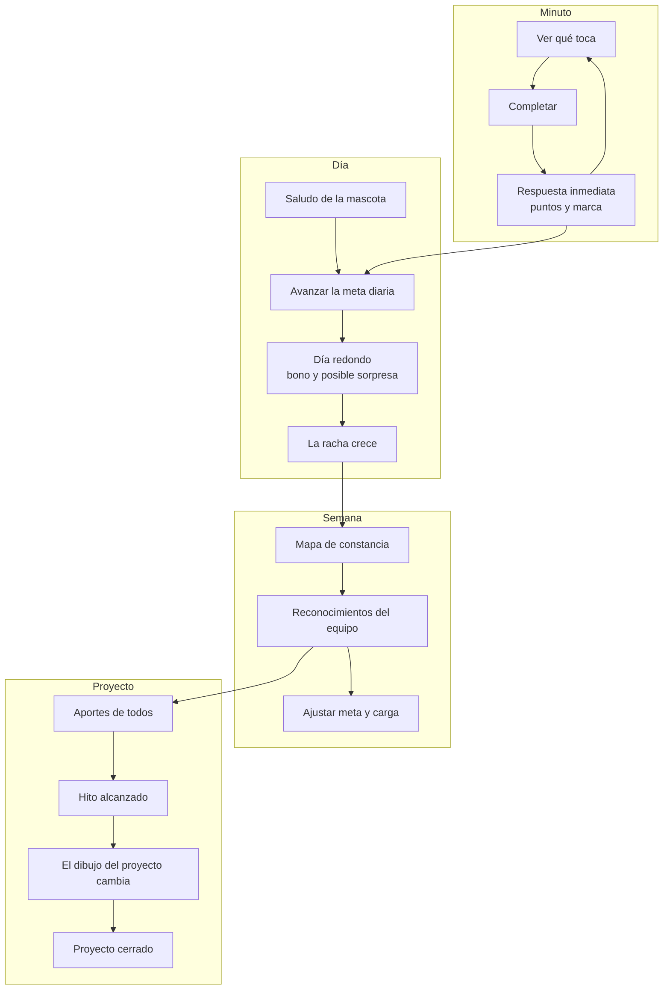

# Motor de gamificación: las reglas que comparten los cinco mundos

Este documento define las **mecánicas** con sus números exactos. No habla de abejas, estrellas ni cuñapés: eso es la piel y vive en la carpeta de cada dirección. Sigue los cinco pasos de diseño del curso (narrativa, objetivos, jugadores, Octalysis y línea base) y termina con el diccionario que traduce cada mecánica a los cinco mundos.

Fundamento teórico: `docs/fundamentos-gamificacion.md` y `docs/casos-de-exito-y-patrones.md`.

## Tabla de contenidos

1. [Paso 1. Narrativa](#1-paso-1-narrativa)
2. [Paso 2. Objetivos y conductas](#2-paso-2-objetivos-y-conductas)
3. [Paso 3. Jugadores](#3-paso-3-jugadores)
4. [Paso 4. Octalysis](#4-paso-4-octalysis)
5. [Reglas del motor](#5-reglas-del-motor)
6. [Bucles de juego](#6-bucles-de-juego)
7. [Recorrido del jugador](#7-recorrido-del-jugador)
8. [Paso 5. Línea base y métricas](#8-paso-5-línea-base-y-métricas)
9. [Ética y bienestar](#9-ética-y-bienestar)
10. [Trazabilidad: mecánica, teoría y código](#10-trazabilidad-mecánica-teoría-y-código)
11. [Funciones puras del motor](#11-funciones-puras-del-motor)
12. [Diccionario de pieles](#12-diccionario-de-pieles)

---

## 1. Paso 1. Narrativa

Las cinco direcciones cuentan la misma historia con distinto escenario:

> Cada actividad que cumples construye algo que se ve. Sola, una actividad es pequeña; juntas, día tras día y entre varios, forman algo que no existía.

| Mundo | Qué se construye | Frase que lo resume |
| :--- | :--- | :--- |
| A · Panal | Un panal, celda por celda | "Cada actividad llena una celda." |
| B · Órbita | Un cielo, estrella por estrella | "Cada vuelta mantiene tu órbita." |
| C · Cumbre | Una ascensión, tramo por tramo | "Cada tramo te sube unos metros." |
| D · Elay con Toco | Un tajibo en flor y el pico pintado de un tucán | "Cada actividad pinta un tramo." |
| E · Elay con Nando y Mechi | Una fiesta que se prepara entre todos | "Cada actividad acerca el buri." |

La narrativa cumple una función concreta: responder "¿para qué marco esta casilla?" con algo más que "para que desaparezca de la lista".

## 2. Paso 2. Objetivos y conductas

Los objetivos medibles están en `propuesta-base.md`, sección 3. Aquí se traducen a las **conductas** que el motor debe provocar. Cada regla de este documento existe para empujar una de ellas.

| Código | Conducta buscada | Objetivo | Qué la facilita |
| :--- | :--- | :--- | :--- |
| C1 | Registrar una actividad en menos de 15 segundos | OE1 | Formulario corto con valores por defecto |
| C2 | Completar al menos una actividad el día en que se registra | OE1 | Recorrido inicial que termina con una insignia |
| C3 | Volver al día siguiente | OE2 | Racha, saludo de la mascota, progreso del día |
| C4 | Cumplir la meta diaria elegida | OE2 | Bono de día redondo, mapa de constancia |
| C5 | Aportar al proyecto todas las semanas | OE4 | Meta común, reconocimiento a la constancia |
| C6 | Mirar el reporte y ajustar la carga | OE3 | Reporte dentro del mundo, lectura inmediata |
| C7 | Retomar después de fallar | OE5 | Protector, mensajes sin culpa, mejor racha conservada |

## 3. Paso 3. Jugadores

| Perfil de Bartle | Presencia | Qué recibe | Qué se evita a propósito |
| :--- | :--- | :--- | :--- |
| **Triunfador** | Principal | Puntos ponderados, niveles, barras por actividad y por proyecto, insignias con criterio visible | Insignias regaladas; reglas ocultas en lo esencial |
| **Socializador** | Principal en equipos | Meta común, aporte visible, ánimos entre miembros, celebración compartida | Que la comparación reemplace a la colaboración |
| **Explorador** | Secundario | Colección del mundo, sorpresas, insignias secretas (siempre adicionales), el propio mundo por descubrir | Que lo secreto sea requisito para avanzar |
| **Competidor** | Acotado | Clasificación opcional, por proyecto y por semana | Clasificación global o permanente |

El perfil competidor no se elimina, se encierra: quien quiere medirse puede hacerlo dentro de su equipo y con marcador que vuelve a cero cada semana. Así nadie llega tarde a una tabla imposible.

## 4. Paso 4. Octalysis

Intensidad de 0 a 3. El diseño carga el lado *White Hat* y usa el *Black Hat* con freno.

| Impulso | Intensidad | Mecánicas que lo activan | Freno |
| :--- | :---: | :--- | :--- |
| CD1 Significado épico | 2 | Narrativa del mundo, meta común del proyecto, hitos compartidos | Sin grandilocuencia: el mundo es pequeño y cercano |
| CD2 Logro y desarrollo | 3 | Puntos, niveles, progreso del día, hitos, insignias | Puntos ponderados y topes contra el abuso |
| CD3 Creatividad y respuesta | 2 | Meta diaria elegida, respuesta inmediata al completar, personalización | Pocas opciones bien elegidas |
| CD4 Propiedad | 2 | Colección, insignias, mapa de constancia propio | Nada se compra con dinero |
| CD5 Influencia social | 3 | Aporte por miembro, ánimos, reconocimientos, pedido de ayuda | Sin clasificación global; nadie pierde por otro |
| CD6 Escasez | 1 | Insignias de hito, protectores limitados a dos | Sin contadores de urgencia |
| CD7 Curiosidad | 1 | Sorpresa en días redondos, insignias secretas | Solo cosmético; nunca decide el avance |
| CD8 Evitación de pérdida | 1 | Racha | Protector automático, día de descanso, pausa, mejor racha conservada |

**Balance.** White Hat (CD1 + CD2 + CD3) suma 7; Black Hat (CD6 + CD7 + CD8) suma 3. Intrínsecos (CD3 + CD5 + CD7) suman 6; extrínsecos (CD2 + CD4 + CD6) suman 6. El sistema arranca con recompensa extrínseca (puntos el primer día) y se sostiene con motivación intrínseca (equipo, constancia propia, colección).

Cada mundo desplaza este balance sin romperlo. Ese énfasis es lo que hace que las cinco direcciones sean estrategias distintas y no solo dibujos distintos:

| Mundo | Impulsos que acentúa | Perfil al que más le habla |
| :--- | :--- | :--- |
| A · Panal | CD2 y CD5: construir juntos | Triunfador y socializador |
| B · Órbita | CD3 y CD7: ritmo propio y descubrimiento | Explorador |
| C · Cumbre | CD1 y CD2: la expedición y la altura ganada | Triunfador |
| D · Elay con Toco | CD4 y CD7: coleccionar y cuidar lo propio | Explorador y socializador |
| E · Elay con Nando y Mechi | CD5 y CD1: pertenencia e identidad | Socializador |

## 5. Reglas del motor

### 5.1 Puntos

| Evento | Puntos | Por qué |
| :--- | :---: | :--- |
| Completar una actividad recurrente | 10 | Pequeña y frecuente: premia el hábito |
| Completar una actividad única | 25 | Exige más decisión y esfuerzo |
| Única de prioridad alta | 35 | La prioridad la fija quien la crea, con tope (ver 5.2) |
| Única completada después de su vencimiento | 15 | Suma menos, pero suma: ponerse al día no se castiga |
| Cuota semanal cumplida (actividad de N veces por semana) | +15 | Refuerza las recurrentes flexibles |
| Día redondo (meta diaria cumplida) | +20 | Premia cerrar el día, no acumular |
| Cada 7 días de racha | +50 | Hito de constancia |
| Hito de proyecto (20, 40, 60, 80 %) | +30 | A cada miembro que aportó en ese tramo |
| Proyecto cerrado (100 %) | +100 | A cada miembro con al menos un aporte |

Ejemplo usado en todas las maquetas: tres actividades completadas hoy (dos recurrentes y una única) dan 10 + 10 + 25 = **45 puntos**.

### 5.2 Reglas contra el abuso

| Regla | Detalle |
| :--- | :--- |
| Una ocurrencia por fecha | Una recurrente solo puntúa una vez por cada fecha programada |
| Actividades relámpago | Si se crea y se completa en menos de un minuto, vale la mitad; máximo tres por día con puntos |
| Tope suave diario | Desde la undécima actividad completada en el día, cada una vale 2 puntos |
| Prioridad alta limitada | Máximo dos únicas de prioridad alta por día |
| Aporte personal | En un proyecto, el aporte queda a nombre de quien completa la actividad |
| Desmarcar revierte | Los puntos son derivados: al desmarcar, desaparecen |

Todas las reglas se publican en la pantalla "Cómo se ganan los puntos". La transparencia es parte del diseño: el triunfador necesita sentir que el logro es justo.

### 5.3 Niveles

| Nivel | Puntos acumulados | Tramo | Cuándo llega con uso constante |
| :---: | :---: | :---: | :--- |
| 1 | 0 | 100 | Al registrarse |
| 2 | 100 | 150 | Día 2 |
| 3 | 250 | 200 | Día 5 |
| 4 | 450 | 250 | Día 9 |
| 5 | 700 | 300 | Segunda semana |
| 6 | 1000 | 400 | Tercera semana |
| 7 | 1400 | 500 | Cuarta semana |
| 8 | 1900 | 600 | Quinta o sexta semana |
| 9 | 2500 | 700 | Séptima semana |
| 10 | 3200 | — | Segundo mes |

Los primeros niveles llegan rápido para dar sensación de competencia; los últimos piden constancia. El estado de ejemplo de las maquetas es **640 puntos, nivel 4, faltan 60 para el nivel 5**. Cada mundo le pone nombre propio a los diez niveles.

### 5.4 Racha, día activo y día redondo

| Concepto | Regla |
| :--- | :--- |
| **Día activo** | Al menos una actividad completada. Mantiene la racha |
| **Día redondo** | Completadas mayor o igual que la meta diaria (o que todas las programadas, si son menos). Da el bono de +20 y la marca completa en el mapa de constancia |
| **Día libre** | Sin actividades programadas o marcado como descanso. No rompe ni suma |
| **Cambio de día** | A las 03:00, no a medianoche: quien estudia de noche no pierde el día por minutos |
| **Racha rota** | Vuelve a cero, pero se conservan la mejor racha y todo el mapa de constancia |

La racha se mantiene con poco (un día activo) y el premio grande está en el día redondo. Así la racha da continuidad sin volverse una amenaza.

### 5.5 Protector, descanso y pausa

| Mecánica | Regla |
| :--- | :--- |
| **Protector de racha** | Se recibe uno al terminar el recorrido inicial y uno más cada 7 días de racha. Máximo dos guardados. Se usa solo, cuando un día programado queda en cero |
| **Día de descanso** | La persona puede fijar un día de la semana sin actividades esperadas |
| **Pausa** | Hasta 14 días seguidos. Congela racha y avisos; la mascota descansa |

Estado de ejemplo: racha de 12 días y 2 protectores (uno de regalo y uno ganado en el día 7).

### 5.6 Meta diaria

Se elige en el recorrido inicial: 3 (tranquila), 5 (constante) o 7 (intensa). Se puede cambiar cuando se quiera desde el perfil. Si durante dos semanas la persona cumple menos de la mitad de los días, el sistema **propone** bajarla; nunca la cambia solo.

### 5.7 Proyectos y equipos

| Mecánica | Regla |
| :--- | :--- |
| **Avance** | Actividades completadas sobre actividades totales del proyecto |
| **Hitos** | Cinco: 20, 40, 60, 80 y 100 %. Cada uno cambia el dibujo del proyecto y se celebra en grupo |
| **Aporte** | Por miembro: actividades completadas y días con aporte |
| **Sin castigo compartido** | El retraso de una persona no resta nada a las demás |
| **Ánimos** | Cada miembro puede enviar hasta tres por día. No dan puntos |
| **Pedido de ayuda** | Quien se traba puede marcar una actividad como "necesito una mano"; cualquier miembro puede tomarla |
| **Clasificación opcional** | Apagada por defecto. Si el propietario la enciende: solo del proyecto, solo de la semana |

Reconocimientos semanales del equipo, calculados cada lunes:

| Reconocimiento | Criterio | Qué premia |
| :--- | :--- | :--- |
| **Constante** | Más días con aporte en la semana (si hay empate, se comparte) | Regularidad, no volumen |
| **Empujón** | Completó la actividad que cruzó un hito | Momento decisivo |
| **Rescate** | Tomó y completó una actividad con pedido de ayuda | Colaboración |

### 5.8 Insignias

Nombres genéricos; cada mundo los rebautiza.

| Insignia | Criterio | Tipo |
| :--- | :--- | :--- |
| Primer paso | Completar la primera actividad | Inicio |
| Día redondo | Cumplir la meta diaria por primera vez | Inicio |
| Semana entera | Racha de 7 días | Constancia |
| Mes entero | Racha de 30 días | Constancia |
| Cien días | Racha de 100 días | Constancia |
| Regreso | Volver a un día activo después de romper una racha | Constancia |
| Puntual | Diez únicas completadas antes de vencer | Logro |
| Cuota firme | Cuatro semanas seguidas cumpliendo una actividad de N veces por semana | Logro |
| Al día | Dejar en cero las actividades vencidas | Logro |
| Primer proyecto | Crear un proyecto y vincular al menos a una persona | Equipo |
| Buen anfitrión | Tres invitaciones aceptadas | Equipo |
| Primer hito | Alcanzar el 20 % en un proyecto | Equipo |
| Proyecto cerrado | Llegar al 100 % | Equipo |
| Mano amiga | Tres rescates | Equipo |
| Secretas (3) | Definidas por cada mundo | Exploración |

"Regreso" es deliberada: reconoce a quien vuelve después de fallar, que es justo el momento en que más gente abandona.

### 5.9 Colección y sorpresas

- En cada día redondo hay una probabilidad de 1 en 4 de recibir una pieza de la colección del mundo. Si pasan siete días redondos sin pieza, la octava es segura.
- Las piezas son cosméticas. No dan puntos ni ventaja.
- La sorpresa no rompe la pureza de los reducers: el azar es una función pura de la persona y la fecha (ver sección 11).

### 5.10 Estados de la mascota

Se evalúan en este orden; gana el primero que se cumple.

| Estado | Condición | Qué comunica |
| :--- | :--- | :--- |
| Descansando | Pausa activa o día de descanso | "Hoy no se espera nada de ti" |
| Celebrando | Día redondo | "Lo lograste" |
| Feliz | La mitad o más de lo de hoy está hecho | "Vas bien" |
| Animando | Al menos una actividad hecha | "Ya arrancaste" |
| Preocupada | Después de las 18:00, cero hechas y racha en juego | "Todavía hay tiempo" |
| Esperando | Cualquier otro caso | "Aquí estoy cuando quieras" |

El estado "preocupada" nunca culpa. La mascota se preocupa por la racha, no reprocha a la persona.

### 5.11 Celebraciones

| Intensidad | Cuándo | Cómo |
| :--- | :--- | :--- |
| Pequeña | Completar una actividad | La marca se llena y los puntos suben. Menos de medio segundo. No interrumpe |
| Mediana | Día redondo, cuota semanal, insignia | Tarjeta con la mascota durante dos segundos. Se puede ignorar |
| Grande | Subir de nivel, hito de proyecto, hito de racha, proyecto cerrado | Ventana con la mascota, la recompensa y la siguiente meta |

Si coinciden varias, se muestran en una sola ventana. Con movimiento reducido activado, las animaciones se reemplazan por cambios de estado sin desplazamiento.

## 6. Bucles de juego



**Modelo de gancho (Hook).**

| Fase | En la plataforma |
| :--- | :--- |
| Disparador | Externo: aviso diario a la hora elegida. Interno: "¿qué me toca hoy?" |
| Acción | Completar con un toque |
| Recompensa variable | Puntos fijos, más la sorpresa ocasional y el reconocimiento del equipo |
| Inversión | Actividades creadas, racha, colección y mapa de constancia: todo lo que hace que mañana valga más |

**Modelo de Fogg (B = MAP).**

| Factor | Cómo se cubre |
| :--- | :--- |
| Motivación | Narrativa, progreso visible, equipo |
| Capacidad | Completar pide un toque; crear pide un campo obligatorio |
| Disparador | Saludo de la mascota al entrar y aviso diario opcional |

## 7. Recorrido del jugador

| Fase | Cuándo | Qué necesita | Qué le da el sistema |
| :--- | :--- | :--- | :--- |
| **Descubrimiento** | Minutos 0 a 5 | Entender de qué va y ganar algo | Recorrido de tres pasos, primera actividad, insignia "Primer paso", un protector de regalo |
| **Incorporación** | Días 1 a 7 | Formar la rutina sin agobio | Niveles rápidos, primer día redondo, racha de 7 días con protector |
| **Hábito** | Semanas 2 a 6 | Variedad y sentido | Proyectos, reconocimientos de equipo, colección, cuotas semanales |
| **Maestría** | Después | Autonomía y aporte a otros | Metas más altas, rescates, proyectos cerrados, insignias de largo plazo |

Las mecánicas se **desbloquean en este orden**. El primer día no aparecen la colección ni los reconocimientos: una pantalla con todo desde el inicio es la forma más rápida de que alguien no se sienta capaz.

## 8. Paso 5. Línea base y métricas

Aún no hay datos: el proyecto está empezando. Lo que se define aquí es **cómo se medirá** el estado actual para poder comparar después.

**Plan de medición.**

1. Semana 0 (línea base): un grupo pequeño usa la plataforma con la capa de juego apagada (`ajustes.gamificacion = false`): solo lista y casillas.
2. Semanas 1 y 2: el mismo grupo usa la plataforma con el motor encendido.
3. Se comparan las métricas de la tabla, calculadas a partir de la tabla `eventos`.

| Métrica | Fórmula | Objetivo |
| :--- | :--- | :--- |
| Activación | Registros con una actividad completada el día 1, sobre registros | OE1 |
| Días activos por semana | Promedio de días con al menos una actividad completada | OE2 |
| Tasa de día redondo | Días redondos sobre días con actividades programadas | OE2 |
| Retención al día 7 | Personas activas el día 7 sobre registradas | OE2 |
| Cumplimiento de recurrentes | Ocurrencias completadas sobre programadas | OE2 |
| Reparto del aporte | Miembros con aporte semanal sobre miembros del proyecto | OE4 |
| Recuperación | Rachas salvadas con protector o reanudadas en tres días, sobre rachas interrumpidas | OE5 |
| Lectura del reporte | Segundos hasta responder "¿cuánto falta y quién aportó?" en una prueba guiada | OE3 |

La gráfica de estado actual que pide la metodología se arma con la semana 0: barras de días activos por persona y cumplimiento de recurrentes. Hasta tener esos datos, cualquier número sería inventado.

## 9. Ética y bienestar

1. **Sin culpa.** Ningún mensaje reprocha. Tras una racha rota: se muestra la mejor racha y la opción de retomar.
2. **Sin castigo al equipo.** El retraso de uno no resta a los demás.
3. **Sin urgencia artificial.** No hay cuentas regresivas ni ofertas que caducan.
4. **Reglas visibles.** Todo lo que da puntos está explicado en una pantalla.
5. **Descanso legítimo.** Día de descanso, pausa y protector existen para que parar no sea perder.
6. **Avisos medidos.** Como máximo uno por día, a la hora que la persona elige, y se pueden apagar.
7. **Comparación acotada.** La clasificación es opcional, del proyecto y de la semana.
8. **Datos propios.** El reporte personal solo lo ve su dueño; el equipo ve únicamente lo que ocurre dentro del proyecto.
9. **Respeto cultural.** En las direcciones cruceñas, el vocabulario y los personajes celebran, no caricaturizan. Toda palabra o rasgo dudoso se valida con personas de Santa Cruz antes de publicarse.

## 10. Trazabilidad: mecánica, teoría y código

| Mecánica | Impulso | Perfil | Motivación | Acción de Redux | Selector | Pantalla |
| :--- | :--- | :--- | :--- | :--- | :--- | :--- |
| Completar actividad | CD2 | Triunfador | Extrínseca | `actividad/completada` | `selectProgresoHoy` | P04, P05 |
| Puntos ponderados | CD2 | Triunfador | Extrínseca | `actividad/completada` | `selectPuntos` | P04, P11 |
| Niveles | CD2 | Triunfador | Extrínseca | Derivado | `selectNivel` | P04, P11 |
| Meta diaria elegida | CD3 | Todos | Intrínseca | `ajustes/metaCambiada` | `selectProgresoHoy` | P03, P11 |
| Racha | CD8 | Triunfador | Extrínseca | Derivado de eventos | `selectRacha` | P04 |
| Protector y descanso | CD8 con freno | Todos | Intrínseca | `racha/protectorUsado`, `ajustes/pausaActivada` | `selectRacha` | P04, P11 |
| Mapa de constancia | CD4 | Triunfador | Intrínseca | Derivado | `selectConstancia` | P04, P10 |
| Meta común del proyecto | CD1, CD5 | Socializador | Intrínseca | `actividad/completada` con `proyectoId` | `selectAvanceProyecto` | P07, P08 |
| Aporte por miembro | CD5 | Socializador | Intrínseca | Derivado | `selectAvanceProyecto` | P08, P10 |
| Ánimos | CD5 | Socializador | Intrínseca | `animo/enviado` | `selectAnimos` | P08 |
| Pedido de ayuda y rescate | CD5 | Socializador | Intrínseca | `ayuda/pedida`, `ayuda/tomada` | `selectPedidosDeAyuda` | P08 |
| Reconocimientos semanales | CD5 | Socializador | Intrínseca | Derivado | `selectReconocimientos` | P08 |
| Clasificación opcional | CD5 | Competidor | Extrínseca | `proyecto/clasificacionCambiada` | `selectClasificacionSemanal` | P08 |
| Insignias | CD2, CD4 | Triunfador | Extrínseca | Derivado | `selectInsignias` | P11, P12 |
| Colección y sorpresa | CD7, CD4 | Explorador | Intrínseca | Derivado con semilla | `selectColeccion` | P11, P12 |
| Mascota | CD1, CD3 | Todos | Intrínseca | Derivado | `selectEstadoMascota` | Todas |

## 11. Funciones puras del motor

Todo el motor se puede probar sin interfaz ni base de datos.

```js
// Puntos de un evento. Sin estado, sin fecha del sistema, sin efectos.
export const puntosDeEvento = (evento, contexto) => {
  const base = { recurrente: 10, unica: 25 }[evento.tipo];
  const conPrioridad = evento.tipo === 'unica' && evento.prioridad === 'alta' ? 35 : base;
  const conAtraso = evento.atrasada ? 15 : conPrioridad;
  const conRelampago = evento.relampago ? Math.floor(conAtraso / 2) : conAtraso;
  return contexto.completadasHoy >= 10 ? 2 : conRelampago;
};

// Nivel a partir de los puntos: una búsqueda en una tabla.
const UMBRALES = [0, 100, 250, 450, 700, 1000, 1400, 1900, 2500, 3200];
export const nivelDe = (puntos) => {
  const nivel = UMBRALES.filter((u) => puntos >= u).length;
  const siguiente = UMBRALES[nivel] ?? null;
  return { nivel, faltan: siguiente === null ? 0 : siguiente - puntos };
};

// Racha: se reduce la lista de días, del más reciente hacia atrás.
export const rachaDe = (dias) =>
  dias.reduce(
    (acc, dia) => {
      if (acc.cortada) return acc;
      if (dia.libre) return acc;
      if (dia.activo) return { ...acc, dias: acc.dias + 1 };
      if (dia.protegido) return acc;
      return { ...acc, cortada: true };
    },
    { dias: 0, cortada: false }
  ).dias;

// Azar sin efectos: la misma persona y la misma fecha dan siempre el mismo resultado.
export const semillaDelDia = (usuarioId, fecha) =>
  [...`${usuarioId}:${fecha}`].reduce((h, c) => (h * 31 + c.charCodeAt(0)) >>> 0, 7);

export const haySorpresa = (usuarioId, fecha, diasRedondosSinPieza) =>
  diasRedondosSinPieza >= 7 || semillaDelDia(usuarioId, fecha) % 4 === 0;
```

`nivelDe(640)` devuelve `{ nivel: 4, faltan: 60 }`, que es el estado de las maquetas.

## 12. Diccionario de pieles

Esta tabla es el contrato entre el motor y los mundos. En código es el objeto que devuelve `selectTextos`.

| Concepto del motor | A · Panal | B · Órbita | C · Cumbre | D · Elay con Toco | E · Elay con Nando y Mechi |
| :--- | :--- | :--- | :--- | :--- | :--- |
| Mascota | Zum, abeja | Nova, estrella | Kusi, llama | Toco, tucán | Nando y Mechi |
| Saludo | ¡Buen vuelo! | Buen despegue. | Hoy toca subir. | ¡Elay! | ¡Elay! |
| Actividad | Celda | Misión | Tramo | Actividad | Actividad |
| Recurrente | Celda de ronda | Órbita (cada cumplimiento es una vuelta) | Tramo de rutina | Recurrente | Costumbre |
| Puntos | Gotas de miel | Destellos | Metros | Cuñapés | Cuñapés |
| Nivel (el 4 de ejemplo) | Exploradora | Navegante | Guía de ruta | Rama 4 del tajibo | 4to anillo |
| Racha | Racha de vuelo | Racha en órbita | Racha de ascenso | Jenecherú | Jenecherú |
| Protector | Reserva de miel | Escudo | Refugio | Hamaca | Cómper |
| Día de descanso | Día sin flores | Día en crucero | Día de aclimatación | Siesta | Siesta |
| Día redondo | Panal cerrado | Cielo encendido | Jornada completa | Pico pintado | Tapeque completo |
| Proyecto | Colmena | Constelación | Expedición | Comparsa | Comparsa |
| Miembros | Enjambre | Tripulación | Cordada | Comparseros | Comparseros |
| Los cinco hitos | Cuadros de la colmena | Estrellas guía | Campamentos | Anillos | Etapas del buri |
| Proyecto cerrado | Enjambrazón: nace una colmena nueva | La constelación recibe nombre | Cumbre | Buri | Buri |
| Mapa de constancia | Panal de constancia | Cielo del mes | Altitud ganada | Florada del tajibo | Florada del tajibo |
| Reportes | Reportes | Bitácora | Bitácora | Reportes | Reportes |
| Insignias | Sellos de cera | Parches de misión | Banderines | Álbum del monte | Horneados |
| Colección | Mieles (una por flor) | Cometas | Hallazgos del sendero | Visitas en la rama | Diccionario camba |
| Sorpresa | Flor rara | Cometa | Hallazgo | Visita | Yapa |
| Constante de la semana | Abeja constante | Estrella polar | Paso firme | Tiluchi de la semana | Tiluchi de la semana |
| Ánimo | Zumbido | Señal | Eco | Invitar un somó | Un "metele" |
| Pedido de ayuda | Llamar al enjambre | Pedir relevo | Pedir cuerda | Pedir una mano | Pedir una mano |

Notas:

- **"Anillo" tenía dos usos** en los tableros D y E (nivel personal e hito del proyecto). Se resolvió así: en D los anillos son los hitos de la comparsa y el nivel personal son las ramas del tajibo por las que sube Toco; en E los anillos son el nivel personal y los hitos de la comparsa son las cinco etapas para armar el buri.
- Cada mundo limita su vocabulario propio y siempre lo acompaña de la palabra común la primera vez que aparece ("Jenecherú: tu racha").
- Las palabras cruceñas y su grado de verificación están en el glosario de las carpetas D y E.
