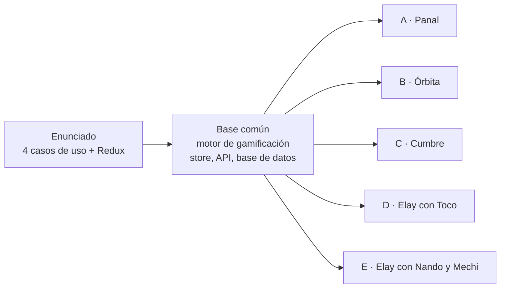
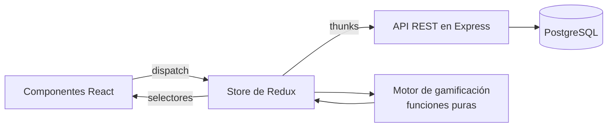

# Propuesta base del proyecto: plataforma gamificada de actividades

Documento común a las cinco direcciones (A Panal, B Órbita, C Cumbre, D Elay con Toco, E Elay con Nando y Mechi). Define lo que **no cambia** entre ellas: el problema, los casos de uso, las pantallas, la arquitectura y el modelo de datos. Cada carpeta de dirección aporta lo que sí cambia: el mundo, la mascota, el vocabulario y el diseño visual.

## Tabla de contenidos

1. [Idea central: un motor, cinco pieles](#1-idea-central-un-motor-cinco-pieles)
2. [Problema y propósito](#2-problema-y-propósito)
3. [Objetivos](#3-objetivos)
4. [Usuarios](#4-usuarios)
5. [Casos de uso](#5-casos-de-uso)
6. [Requisitos](#6-requisitos)
7. [Inventario de pantallas](#7-inventario-de-pantallas)
8. [Arquitectura técnica](#8-arquitectura-técnica)
9. [Diseño del store de Redux](#9-diseño-del-store-de-redux)
10. [Modelo de datos](#10-modelo-de-datos)
11. [Modelo de recurrencia](#11-modelo-de-recurrencia)
12. [API](#12-api)
13. [Plan por fases](#13-plan-por-fases)
14. [Trazabilidad con el enunciado](#14-trazabilidad-con-el-enunciado)

---

## 1. Idea central: un motor, cinco pieles

La plataforma se construye una sola vez. Las reglas (puntos, niveles, rachas, metas de equipo) viven en el **motor de gamificación**, que es código puro y no sabe nada de abejas, estrellas ni cuñapés. Encima va una **piel**: un mundo con su mascota, su vocabulario y su sistema visual.



Esto tiene tres consecuencias prácticas:

- **Se puede elegir tarde.** La piel se decide al final sin rehacer el backend ni los reducers.
- **Se puede defender ante el docente.** La regla del curso dice que los objetos sin mecánica son solo decoración; aquí la mecánica existe primero y la piel solo la muestra.
- **La piel es un selector.** El estado de la mascota, el nombre del nivel y el texto de cada mensaje se calculan con funciones puras a partir del store. Cambiar de mundo es cambiar un diccionario, no la lógica.

## 2. Problema y propósito

**Problema.** Las listas de tareas se abandonan: registrar es fácil, sostener el hábito no. En equipos el problema crece, porque no se ve quién aporta ni cuánto falta, y el avance solo aparece cuando ya es tarde.

**Propósito.** Una plataforma que ayude a organizar y cumplir actividades, de forma individual o en equipo, y que muestre el cumplimiento de forma visual, de un vistazo, por actividad y por proyecto.

**Apuesta de diseño.** El competidor no es otra aplicación de tareas, es el abandono. Por eso el diseño prioriza que la persona vuelva mañana: victoria el primer día, constancia premiada por encima del volumen, y una mascota que hace visible el progreso.

## 3. Objetivos

**Objetivo general.** Aumentar el cumplimiento sostenido de actividades individuales y de equipo mediante mecánicas de juego que hagan visible el progreso.

| Código | Objetivo específico | Indicador | Meta propuesta (a validar con uso real) |
| :--- | :--- | :--- | :--- |
| OE1 | Que la persona complete su primera actividad el mismo día en que se registra | % de registros con una actividad completada en el día 1 | 70 % |
| OE2 | Sostener la constancia en actividades recurrentes | Días cumplidos por semana por usuario activo | 4 de 7 |
| OE3 | Que el avance de cada proyecto se entienda sin leer listas | Tiempo hasta responder "¿cuánto falta y quién aportó?" en una prueba con usuarios | Menos de 10 segundos |
| OE4 | Repartir el aporte dentro de los equipos | % de miembros con al menos un aporte semanal | 80 % |
| OE5 | Retener sin presión excesiva | Rachas recuperadas con protector frente a rachas abandonadas | Más recuperadas que abandonadas |

Las metas son hipótesis de diseño. La línea base se mide con la primera versión funcional (ver `motor-de-gamificacion.md`, sección 8).

## 4. Usuarios

| Perfil | Situación | Qué necesita | Qué lo haría abandonar |
| :--- | :--- | :--- | :--- |
| **Ana, estudiante** | Combina hábitos diarios con entregas de la universidad | Ver qué toca hoy y sentir que avanza | Demasiados pasos para registrar algo |
| **Luis, integrante de equipo** | Trabaja en un proyecto final con tres compañeros | Saber qué le toca y que su aporte se note | Un ranking que lo deje último en público |
| **Sofía, coordinadora** | Creó el proyecto y reparte el trabajo | Ver el avance y quién necesita ayuda | Tener que perseguir a cada uno por mensajes |

## 5. Casos de uso

### CU-01. Registro e inicio de sesión

- **Actor:** visitante.
- **Flujo principal:** ingresa nombre, correo y contraseña; el sistema crea la cuenta; pasa al recorrido inicial, donde elige una meta diaria (3, 5 o 7 actividades) y crea su primera actividad.
- **Alternos:** correo ya registrado; contraseña débil; inicio de sesión con credenciales incorrectas; cierre de sesión.
- **Criterios de aceptación:** la sesión persiste al recargar; las contraseñas se guardan con hash; al terminar el recorrido inicial la persona ya ganó su primera insignia.
- **Gancho de gamificación:** victoria temprana y elección propia de la meta (autonomía).

### CU-02. Actividades únicas y recurrentes

- **Actor:** usuario autenticado.
- **Flujo principal:** crea una actividad con título, tipo (única o recurrente), prioridad y, si es única, fecha de vencimiento; si es recurrente, su regla (diaria, días de la semana, N veces por semana, día del mes). La actividad aparece en "Hoy" cuando corresponde y se completa con un toque.
- **Alternos:** editar, posponer, archivar; desmarcar una actividad completada por error; asignarla a un proyecto.
- **Criterios de aceptación:** una recurrente genera sus apariciones sin duplicarse; completar suma puntos según las reglas del motor; desmarcar revierte los puntos; el progreso del día se actualiza al instante.
- **Gancho de gamificación:** respuesta inmediata, racha y protector de racha.

### CU-03. Proyectos y vinculación de usuarios

- **Actor:** usuario autenticado (propietario o miembro).
- **Flujo principal:** crea un proyecto con nombre, descripción y fecha objetivo; invita personas por correo o con un enlace; los invitados aceptan y quedan vinculados; las actividades del proyecto se asignan a miembros; el avance del proyecto se calcula con las actividades completadas.
- **Alternos:** rechazar invitación; quitar un miembro; salir del proyecto; transferir la propiedad; archivar el proyecto.
- **Criterios de aceptación:** solo los miembros ven el proyecto; el aporte de cada miembro es visible; el proyecto muestra cinco hitos (20, 40, 60, 80 y 100 %); ningún miembro pierde puntos por el retraso de otro.
- **Gancho de gamificación:** meta compartida, reconocimiento a la constancia y celebración de hitos.

### CU-04. Reporte con gráficas

- **Actor:** usuario autenticado.
- **Flujo principal:** abre "Reportes" y ve su constancia (mapa de las últimas semanas), el cumplimiento por actividad, la tendencia semanal y, por proyecto, el avance y el aporte de cada miembro.
- **Alternos:** cambiar el periodo; filtrar por proyecto; ver el detalle de una actividad.
- **Criterios de aceptación:** cada actividad y cada proyecto tienen su propio indicador de progreso; los colores no son el único medio para distinguir datos; las gráficas tienen texto alternativo.
- **Gancho de gamificación:** el reporte es parte del mundo (un panal, un cielo, una montaña, un tajibo), no una pantalla aparte y fría.

## 6. Requisitos

### Funcionales

| Código | Requisito | Caso de uso |
| :--- | :--- | :--- |
| RF-01 | Registro, inicio y cierre de sesión | CU-01 |
| RF-02 | Recorrido inicial con meta diaria y primera actividad | CU-01 |
| RF-03 | Crear, editar, posponer y archivar actividades únicas | CU-02 |
| RF-04 | Crear y editar actividades recurrentes con cuatro tipos de regla | CU-02 |
| RF-05 | Completar y desmarcar actividades con respuesta inmediata | CU-02 |
| RF-06 | Calcular puntos, nivel, racha y protectores | CU-02 |
| RF-07 | Crear proyectos y definir su fecha objetivo | CU-03 |
| RF-08 | Invitar y vincular usuarios por correo o enlace | CU-03 |
| RF-09 | Asignar actividades a miembros de un proyecto | CU-03 |
| RF-10 | Mostrar avance del proyecto, hitos y aporte por miembro | CU-03, CU-04 |
| RF-11 | Reporte individual: constancia, cumplimiento por actividad, tendencia | CU-04 |
| RF-12 | Insignias, colección y celebraciones | Transversal |
| RF-13 | Mascota con estados derivados del progreso | Transversal |

### No funcionales

| Código | Requisito |
| :--- | :--- |
| RNF-01 | Redux como única fuente de verdad del estado en el frontend (obligatorio por enunciado) |
| RNF-02 | Reducers puros, estado inmutable y selectores memorizados |
| RNF-03 | Base de datos de código abierto |
| RNF-04 | Accesibilidad: contraste mínimo 4,5:1 en texto, navegación por teclado, textos alternativos |
| RNF-05 | Diseño adaptable: escritorio desde 1280 px y teléfono desde 360 px |
| RNF-06 | Contraseñas con hash y sesión con token de vida corta |
| RNF-07 | Las animaciones respetan la preferencia de movimiento reducido |

## 7. Inventario de pantallas

Estos identificadores se usan en los prompts de Stitch de cada dirección.

| ID | Pantalla | Propósito | Componentes clave | Caso de uso |
| :--- | :--- | :--- | :--- | :--- |
| P01 | Inicio de sesión | Entrar a la cuenta | Mascota, formulario, enlace a registro | CU-01 |
| P02 | Registro | Crear la cuenta | Formulario corto, promesa del producto | CU-01 |
| P03 | Recorrido inicial | Elegir meta diaria y crear la primera actividad | Tres pasos, mascota que guía, primera insignia | CU-01 |
| P04 | Hoy | Ver y cumplir lo del día | Saludo de la mascota, progreso del día, lista de hoy, racha, resumen de proyecto, constancia | CU-02, CU-04 |
| P05 | Actividades | Gestionar todas las actividades | Pestañas (hoy, próximas, recurrentes, archivadas), filtros, lista | CU-02 |
| P06 | Nueva actividad | Crear o editar | Selector única o recurrente, regla de repetición, prioridad, proyecto, vista previa de puntos | CU-02 |
| P07 | Proyectos | Ver los proyectos propios | Tarjetas con avance, miembros e hito actual | CU-03 |
| P08 | Detalle de proyecto | Seguir un proyecto | Visual del avance con hitos, aporte por miembro, actividades del proyecto | CU-03, CU-04 |
| P09 | Invitar personas | Vincular usuarios | Modal con correo, enlace para copiar, invitaciones pendientes | CU-03 |
| P10 | Reportes | Entender el progreso | Mapa de constancia, cumplimiento por actividad, tendencia semanal, únicas frente a recurrentes | CU-04 |
| P11 | Perfil y logros | Ver nivel, insignias y colección | Nivel con barra, insignias ganadas y por ganar, ajustes de meta diaria | Transversal |
| P12 | Celebración | Reconocer un logro | Modal con la mascota celebrando, recompensa y siguiente meta | Transversal |

## 8. Arquitectura técnica

| Capa | Tecnología | Por qué |
| :--- | :--- | :--- |
| Interfaz | React con Vite | Estándar para trabajar con Redux; arranque rápido |
| Estado | Redux Toolkit (`configureStore`, `createSlice`, `createSelector`) | Cumple el requisito de Redux y facilita reducers pequeños y puros |
| Navegación | React Router | Rutas protegidas por sesión |
| Gráficas | SVG propio para las gráficas del mundo (panal, órbitas, ruta, florada); Recharts para barras y líneas comunes | Las gráficas temáticas no existen en ninguna librería |
| Servidor | Node.js con Express | Tecnología de libre elección y de código abierto; mismo lenguaje que el frontend |
| Base de datos | PostgreSQL | Código abierto; relaciones claras entre usuarios, proyectos y actividades |
| Sesión | JWT de vida corta con renovación | Simple y suficiente para el alcance |

El enunciado dice "tecnología libre" para el backend y "libre (obligatorio)" para la base de datos. La frase admite dos lecturas: libre elección o software libre. La propuesta cumple ambas: todo el stack es de libre elección y de código abierto.



## 9. Diseño del store de Redux

El estado se compone de reducers pequeños, uno por mecánica, combinados en un reducer raíz. Los datos de gamificación **no se guardan calculados**: se derivan con selectores a partir de un registro de eventos, que es la forma más directa de aplicar "el estado es una reducción de las acciones en el tiempo".

```js
// Forma del estado
{
  sesion:      { usuario, token, estado },
  actividades: { porId, ids },
  ocurrencias: { porClave },          // clave = actividadId + fecha
  proyectos:   { porId, ids },
  miembros:    { porProyecto },
  eventos:     { lista },             // registro inmutable: quién, qué, cuándo
  ajustes:     { metaDiaria, mundo, movimientoReducido },
  interfaz:    { celebracionPendiente, filtros }
}
```

| Reducer | Responsabilidad | Acciones que escucha |
| :--- | :--- | :--- |
| `sesionReducer` | Usuario y token | `sesion/iniciada`, `sesion/cerrada` |
| `actividadesReducer` | Alta, edición y archivo | `actividad/creada`, `actividad/editada`, `actividad/archivada` |
| `ocurrenciasReducer` | Qué se completó y qué día | `actividad/completada`, `actividad/desmarcada` |
| `proyectosReducer` | Proyectos e hitos | `proyecto/creado`, `proyecto/editado`, `proyecto/archivado` |
| `miembrosReducer` | Vinculación de usuarios | `miembro/invitado`, `miembro/vinculado`, `miembro/retirado` |
| `eventosReducer` | Registro de eventos para puntos y rachas | Todas las acciones con `meta.puntuable` |
| `ajustesReducer` | Meta diaria y mundo activo | `ajustes/metaCambiada`, `ajustes/mundoCambiado` |
| `interfazReducer` | Celebraciones y filtros | `celebracion/mostrada`, `celebracion/cerrada` |

**Acciones etiquetadas.** Cada acción lleva en `meta` la trazabilidad que pide el curso: impulso de Octalysis, perfil de Bartle y tipo de motivación.

```js
const completarActividad = (id, fecha) => ({
  type: 'actividad/completada',
  payload: { id, fecha },
  meta: { puntuable: true, coreDrive: 'CD2', bartle: 'triunfador', motivacion: 'extrinseca' }
});
```

**Selectores (todo lo que se ve es derivado).**

| Selector | Devuelve | Usa |
| :--- | :--- | :--- |
| `selectProgresoHoy` | Completadas, programadas y objetivo de hoy | `ocurrencias`, `actividades`, `ajustes` |
| `selectPuntos` | Puntos totales con topes aplicados | `eventos` |
| `selectNivel` | Nivel, puntos del nivel y faltantes | `selectPuntos` |
| `selectRacha` | Días consecutivos cumplidos y protectores | `eventos`, `ajustes` |
| `selectConstancia` | Matriz día por día de las últimas semanas | `ocurrencias` |
| `selectAvanceProyecto` | Porcentaje, hito actual y aporte por miembro | `ocurrencias`, `miembros` |
| `selectInsignias` | Insignias ganadas y progreso de las pendientes | `eventos` |
| `selectEstadoMascota` | Estado de ánimo de la mascota (seis estados) | `selectProgresoHoy`, `selectRacha`, hora, descanso |
| `selectTextos` | Vocabulario del mundo activo | `ajustes.mundo` |

```js
// La mascota no es decoración: es una función pura del estado.
export const selectEstadoMascota = createSelector(
  [selectProgresoHoy, selectRacha, selectHora, selectEnDescanso],
  (hoy, racha, hora, enDescanso) => {
    if (enDescanso) return 'descansando';
    // hoy.objetivo = el menor entre la meta diaria y lo programado para hoy
    if (hoy.objetivo > 0 && hoy.completadas >= hoy.objetivo) return 'celebrando';
    if (hoy.completadas / Math.max(hoy.objetivo, 1) >= 0.5) return 'feliz';
    if (hoy.completadas > 0) return 'animando';
    if (hora >= 18 && racha.dias > 0) return 'preocupada';
    return 'esperando';
  }
);
```

**Dónde se ve la programación funcional.** Reducers puros sin efectos; estado inmutable; composición con `combineReducers`; selectores compuestos y memorizados; el cálculo de puntos, niveles y rachas como funciones puras que se pueden probar sin interfaz; el historial de acciones permite retroceder y reproducir el estado.

## 10. Modelo de datos

| Tabla | Campos principales | Notas |
| :--- | :--- | :--- |
| `usuarios` | id, nombre, correo, hash_clave, meta_diaria, mundo, creado_en | `mundo` guarda la piel elegida |
| `actividades` | id, usuario_id, proyecto_id, asignado_a, titulo, tipo, prioridad, vence_en, archivada | `tipo`: única o recurrente |
| `reglas_recurrencia` | actividad_id, clase, dias_semana, veces_por_semana, dia_mes, desde, hasta | Una fila por actividad recurrente |
| `ocurrencias` | actividad_id, fecha, completada_en, completada_por | Solo se guardan las completadas |
| `proyectos` | id, nombre, descripcion, propietario_id, fecha_objetivo, archivado | |
| `miembros_proyecto` | proyecto_id, usuario_id, rol, vinculado_en | `rol`: propietario o miembro |
| `invitaciones` | id, proyecto_id, correo, codigo, estado, vence_en | Vinculación por correo o enlace |
| `eventos` | id, usuario_id, tipo, referencia_id, fecha, datos | Fuente de los puntos, rachas e insignias |
| `insignias_usuario` | usuario_id, insignia, ganada_en | Catálogo de insignias en código |

Los puntos, el nivel y la racha no tienen columna propia: se calculan a partir de `eventos`. Así nunca se desincronizan y cualquier cambio de regla se aplica hacia atrás.

## 11. Modelo de recurrencia

| Clase | Ejemplo | Cuándo aparece en "Hoy" |
| :--- | :--- | :--- |
| Diaria | Repasar apuntes | Todos los días |
| Días de la semana | Inglés lunes, miércoles y viernes | Solo esos días |
| Veces por semana | Ejercicio 3 veces por semana | Todos los días hasta alcanzar la cuota |
| Día del mes | Pagar la mensualidad el día 5 | Ese día, o el último día si el mes es más corto |

Las apariciones no se guardan por adelantado. Una función pura, `ocurrenciasEntre(regla, desde, hasta)`, las calcula cuando hacen falta. En la base solo queda lo que se completó.

## 12. API

| Método y ruta | Uso |
| :--- | :--- |
| `POST /auth/registro`, `POST /auth/sesion`, `POST /auth/renovar` | Cuenta y sesión |
| `GET /actividades`, `POST /actividades`, `PATCH /actividades/:id` | Gestión de actividades |
| `POST /actividades/:id/completar`, `DELETE /actividades/:id/completar` | Completar y desmarcar una fecha |
| `GET /proyectos`, `POST /proyectos`, `PATCH /proyectos/:id` | Gestión de proyectos |
| `POST /proyectos/:id/invitaciones`, `POST /invitaciones/:codigo/aceptar` | Vinculación de usuarios |
| `DELETE /proyectos/:id/miembros/:usuarioId` | Quitar un miembro |
| `GET /eventos?desde=` | Registro para reconstruir puntos y rachas |
| `GET /reportes/resumen?periodo=` | Datos agregados para las gráficas |

## 13. Plan por fases

| Fase | Entrega | Cierra |
| :--- | :--- | :--- |
| 0 | Dirección visual elegida y pantallas en Stitch | Diseño |
| 1 | Cuenta, sesión y store base | CU-01 |
| 2 | Actividades únicas y recurrentes, pantalla "Hoy" | CU-02 |
| 3 | Motor de gamificación: puntos, nivel, racha, protector, insignias | RF-06, RF-12 |
| 4 | Proyectos, invitaciones y aporte por miembro | CU-03 |
| 5 | Reportes con gráficas del mundo | CU-04 |
| 6 | Mascota con estados, celebraciones, accesibilidad y pulido | RF-13 |

## 14. Trazabilidad con el enunciado

| Enunciado | Dónde se cumple |
| :--- | :--- |
| Plataforma gamificada para organizar y cumplir actividades | Motor de gamificación y pantalla P04 |
| Individual o en equipo | CU-02 y CU-03 |
| Cumplimiento visual, de un vistazo, por actividad y por proyecto | P04, P08 y P10 |
| Registro e inicio de sesión | CU-01, P01 a P03 |
| Actividades únicas y recurrentes | CU-02, sección 11 |
| Gestión de proyectos con vinculación de usuarios | CU-03, P07 a P09 |
| Reporte con gráficas que resalten el progreso de cada acción | CU-04, P10 |
| Backend de tecnología libre | Node.js con Express |
| Base de datos libre | PostgreSQL |
| Redux obligatorio | Sección 9 |
