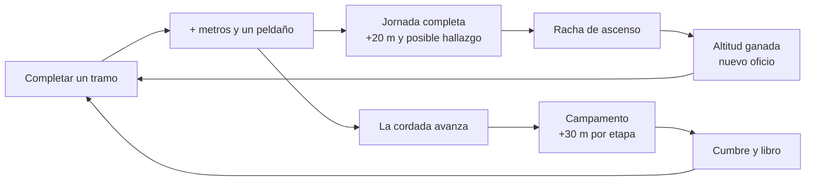

# Estrategia de gamificación: Cumbre

Este documento aplica los cinco pasos de diseño del curso al mundo de la montaña. Las reglas y los números son los de `../00-base-comun/motor-de-gamificacion.md` y no cambian; aquí se define cómo se llaman, cómo se ven, qué impulsos se acentúan y qué mecánica existe solo en Cumbre.

## Tabla de contenidos

1. [Narrativa](#1-narrativa)
2. [Objetivos y conductas](#2-objetivos-y-conductas)
3. [Jugadores](#3-jugadores)
4. [Octalysis de Cumbre](#4-octalysis-de-cumbre)
5. [Mecánicas con nombre propio](#5-mecánicas-con-nombre-propio)
6. [La mecánica insignia: la cordada](#6-la-mecánica-insignia-la-cordada)
7. [Equipo: la expedición](#7-equipo-la-expedición)
8. [Insignias: los banderines](#8-insignias-los-banderines)
9. [Colección y sorpresas: hallazgos del sendero](#9-colección-y-sorpresas-hallazgos-del-sendero)
10. [Estados de Kusi](#10-estados-de-kusi)
11. [Bucles y recorrido del jugador](#11-bucles-y-recorrido-del-jugador)
12. [Línea base y métricas](#12-línea-base-y-métricas)
13. [Riesgos éticos propios y sus frenos](#13-riesgos-éticos-propios-y-sus-frenos)
14. [Trazabilidad](#14-trazabilidad)

---

## 1. Narrativa

> Hay una montaña delante. No se sube de un salto: se sube de a un tramo, con una llama que conoce el camino y una cordada que no deja a nadie atrás.

La historia tiene tres escalas, y cada una responde a una pregunta distinta:

| Escala | Qué es | Pregunta que responde |
| :--- | :--- | :--- |
| **La jornada** | Los tramos de hoy | ¿Qué me toca y cuánto llevo? |
| **La travesía** | La altitud que la persona gana con el tiempo | ¿Estoy avanzando de verdad? |
| **La expedición** | El proyecto que una cordada sube junta | ¿Dónde estamos y cuánto falta? |

A "¿para qué marco esta casilla?", Cumbre contesta: porque sube unos metros, y esos metros no se pierden. La altitud ganada es una suma acumulada; por construcción nunca baja. Un mal día se ve como un llano, no como una caída.

## 2. Objetivos y conductas

Los objetivos (OE1 a OE5) y las conductas (C1 a C7) son los comunes. Así empuja Cumbre cada conducta:

| Conducta | Cómo la empuja Cumbre |
| :--- | :--- |
| C1. Registrar en menos de 15 segundos | "Nuevo tramo" pide solo el nombre; lo demás tiene valor por defecto y muestra cuántos metros dará |
| C2. Completar algo el primer día | El recorrido inicial ocurre en el campamento base y termina con el banderín "Primer paso" y un refugio de regalo |
| C3. Volver al día siguiente | Racha de ascenso y el mensaje de Kusi sobre lo que le falta a la cordada |
| C4. Cumplir la meta diaria | Cinco peldaños ascendentes que se llenan; al cerrarlos, jornada completa (+20 m) |
| C5. Aportar al proyecto cada semana | La ruta dice a cuántos tramos está el siguiente campamento; cada semana alguien distinto abre huella |
| C6. Mirar el reporte y ajustar | La Bitácora abre con una sola cifra grande y una gráfica que siempre sube |
| C7. Retomar después de fallar | Refugio automático, altitud que no baja y el banderín "De vuelta al sendero" |

Cumbre apuesta sobre todo por **OE3** (entender el avance sin leer listas) y **OE2** (sostener la constancia).

## 3. Jugadores

| Perfil | Presencia en Cumbre | Qué recibe | Riesgo y compensación |
| :--- | :--- | :--- | :--- |
| **Triunfador** | Principal. Es su mundo | Metros, oficios de montaña, campamentos, banderines con criterio visible, una gráfica que solo sube | Que persiga metros y no descanso. Se compensa dando al descanso un lugar en el mundo: aclimatación |
| **Socializador** | Fuerte en equipos | Cordada, ecos, pedir y dar cuerda, abrir huella, libro de cumbre | Que la cuerda se sienta como presión. La cordada ocupa una sola posición y no hay último |
| **Explorador** | El menos atendido | Hallazgos del sendero por zonas, paisaje que cambia con el nivel, tres banderines secretos | Una ruta con una sola cumbre ofrece poco que descubrir. Se compensa con la colección y con datos reales en cada hallazgo |
| **Competidor** | Acotado | "Metros de la semana": clasificación opcional, del proyecto y de la semana | Apagada por defecto; solo la enciende quien creó la expedición |

## 4. Octalysis de Cumbre

Respecto al motor, Cumbre sube un punto el CD1 y mantiene el CD2 en el máximo.

| Impulso | Motor | Cumbre | Mecánica en este mundo | Freno |
| :--- | :---: | :---: | :--- | :--- |
| CD1 Significado épico | 2 | 3 | La expedición, la cordada, el libro de cumbre | Tono sobrio: es una excursión entre compañeros, no una hazaña |
| CD2 Logro y desarrollo | 3 | 3 | Metros, altitud ganada, oficios, campamentos, banderines | Puntos ponderados y topes del motor; "Cómo se ganan los metros" siempre visible |
| CD3 Creatividad y respuesta | 2 | 2 | Elegir el paso (3, 5 o 7), elegir el tramo clave al abrir huella, respuesta al completar | Pocas opciones |
| CD4 Propiedad | 2 | 2 | Banderines, hallazgos, la propia curva de altitud | Nada se compra |
| CD5 Influencia social | 3 | 3 | Aporte de la cordada, ecos, pedir cuerda, paso firme | Sin clasificación global; orden de ingreso |
| CD6 Escasez | 1 | 1 | Refugios limitados a dos; zonas de hallazgos que se abren con el nivel | Sin cuentas regresivas ni "ventanas" de tiempo |
| CD7 Curiosidad | 1 | 1 | Hallazgo ocasional en jornadas completas; banderines secretos | Solo cosmético |
| CD8 Evitación de pérdida | 1 | 1 | Racha de ascenso | Refugio automático, aclimatación, campamento base; la altitud nunca baja |

**Balance.** White Hat (CD1 + CD2 + CD3) suma 8; Black Hat (CD6 + CD7 + CD8) suma 3. Extrínsecos (CD2 + CD4 + CD6) suman 6; intrínsecos (CD3 + CD5 + CD7) suman 6. Es la dirección con más peso en el lado de logro y propósito, y por eso la que más cuida el freno del descanso.

## 5. Mecánicas con nombre propio

| Concepto del motor | En Cumbre | Regla (sin cambios) | Cómo se ve |
| :--- | :--- | :--- | :--- |
| Actividad | Tramo | — | Fila con casilla |
| Recurrente | Tramo de rutina | 10 puntos por ocurrencia | "De rutina · diario", "+10 m" |
| Única | Tramo único | 25; alta 35; vencida 15 | "Único · vence hoy", "+25 m" |
| Puntos | Metros | Tabla 5.1 del motor | Cifra con "m" |
| Meta diaria | El paso: tranquilo (3), constante (5), intenso (7) | Se cambia cuando se quiera | Cinco peldaños en "Tramos de hoy" |
| Día redondo | Jornada completa | +20 | El último peldaño lleva banderín; Kusi celebra |
| Cuota semanal cumplida | Semana de rutina cumplida | +15 | Marca en el tramo de rutina |
| Racha | Racha de ascenso | Un tramo al día la mantiene; +50 cada 7 días | Ficha con banderín: "Racha de 12 días" |
| Protector | Refugio | Uno de regalo, uno cada 7 días, máximo dos | Ficha con icono de refugio: "2 refugios" |
| Día de descanso | Día de aclimatación | Un día fijo por semana | Kusi echada junto a la carpa; rellano en el perfil |
| Pausa | Volver al campamento base | Hasta 14 días | Kusi en el campamento base |
| Cambio de día | Amanecer de ruta | A las 03:00 | No se muestra; se explica en ayuda |
| Mapa de constancia | Altitud ganada | Derivado | Área acumulada por semana y perfil día por día |
| Clasificación opcional | Metros de la semana | Del proyecto y de la semana | Lista corta dentro de la expedición |
| Reglas visibles | Cómo se ganan los metros | Publica las tablas 5.1 y 5.2 | Pantalla de ayuda enlazada desde cada "+ m" |

**Los diez niveles.** Son oficios de montaña, escritos en forma neutra. El paisaje detrás de Kusi cambia por zonas.

| Nivel | Oficio | Metros | Zona del paisaje |
| :---: | :--- | :---: | :--- |
| 1 | Caminante | 0 | Valle |
| 2 | Senderista | 100 | Valle |
| 3 | Excursionista | 250 | Valle |
| 4 | Guía de ruta | 450 | Ladera |
| 5 | Montañista | 700 | Ladera |
| 6 | Andinista | 1000 | Ladera |
| 7 | Vigía de altura | 1400 | Puna |
| 8 | Cabeza de cordada | 1900 | Puna |
| 9 | Guía de cumbre | 2500 | Puna |
| 10 | Leyenda de la cordillera | 3200 | Nieve y cielo |

Estado de ejemplo: 640 m, nivel 4, Guía de ruta; faltan 60 m para Montañista.

## 6. La mecánica insignia: la cordada

Una cordada es un grupo que sube atado a la misma cuerda: si alguien resbala, los demás lo sostienen. En Cumbre es la forma de trabajar en equipo, y tiene cuatro piezas que solo existen en este mundo.

**1. Una sola posición.** En la ruta, el equipo es un único punto. Los miembros no están repartidos por la montaña según lo que aportaron: suben juntos. El aporte individual se ve en la lista de la cordada, en orden de ingreso y unido por una cuerda.

**2. Abrir huella.** En nieve, quien va delante abre la huella y los demás pisan sobre ella; como cansa, el puesto rota.

| Regla | Detalle |
| :--- | :--- |
| Rotación | Cada lunes pasa al siguiente miembro, en orden de ingreso |
| Qué hace | Elige un tramo pendiente de la expedición como **tramo clave** de la semana |
| Efecto | Cuando alguien lo completa, la ruta gana una marca de "paso clave" y la cordada recibe el aviso |
| Metros | Ninguno adicional: los números del motor no cambian |
| Ceder | Quien no pueda esa semana cede la huella a la siguiente persona, sin costo |
| Equipos de una persona | La mecánica no aparece |

**3. Pedir cuerda y dar cuerda.** Es el pedido de ayuda del motor. Quien se traba marca el tramo con "Pedir cuerda"; en la lista de la cordada aparece un cabo suelto junto a su nombre. Cualquier miembro puede "dar cuerda": toma el tramo. Al completarlo recibe el reconocimiento "Cuerda tendida".

**4. El libro de cumbre.** En muchas cimas hay un cuaderno donde quien llega deja su nombre. Al cerrar una expedición, cada miembro firma con una línea de hasta 80 caracteres. La página queda para siempre en la Bitácora con el nombre de la expedición, las fechas, los tramos, los pasos clave y las firmas.

**Por qué.** Abrir huella reparte la iniciativa, no solo el trabajo: cada semana alguien distinto decide qué es lo importante, sin importar cuánto haya aportado. Apunta a OE4 (repartir el aporte) con CD5 y CD3. El libro de cumbre convierte el cierre en un recuerdo compartido: CD1 y CD4.

**Rasgo personal del mundo: la altitud no baja.** Fuera de los equipos, lo propio de Cumbre es que el progreso se dibuja siempre hacia arriba. Los días de aclimatación aparecen como un rellano con una carpa; los días en cero, como un llano sin marca.

## 7. Equipo: la expedición

**Los cinco hitos.** Entre dos hitos hay una etapa.

| Hito | Avance | Nombre | Qué cambia en el dibujo |
| :---: | :---: | :--- | :--- |
| 1 | 20 % | Campamento 1 | Aparece la primera carpa; el sendero pasa de punteado a continuo hasta ella |
| 2 | 40 % | Campamento 2 | Segunda carpa; el campamento 1 queda marcado en color Sol |
| 3 | 60 % | Campamento 3 | La cordada cruza la mitad de la montaña; aparece una laguna pequeña junto a la carpa |
| 4 | 80 % | Campamento 4 | La cordada queda sobre la línea de nieve; solo falta el tramo final punteado |
| 5 | 100 % | Cumbre | Kusi junto al banderín; la ventana oscura de cumbre abre el libro |

Cada hito da +30 m a cada miembro que aportó en esa etapa; la cumbre da +100 m a cada miembro con al menos un aporte. Con los datos de ejemplo: 18 de 30 tramos, campamento 3, faltan 6 tramos para el campamento 4.

**Reconocimientos semanales** (cada lunes):

| Motor | En Cumbre | Criterio |
| :--- | :--- | :--- |
| Constante | Paso firme | Más días con aporte en la semana; el empate se comparte |
| Empujón | Último largo | Completó el tramo que alcanzó un campamento |
| Rescate | Cuerda tendida | Tomó y completó un tramo con pedido de cuerda |

**Ecos.** Hasta tres por día y por persona, sin metros. Se eligen de una lista corta: "Vamos.", "Buen tramo.", "Te esperamos en el campamento.", "Con calma, pero sin parar.". El eco llega como una ficha pequeña junto al avatar.

**Sin castigo compartido.** Si alguien no aporta, la cordada no retrocede ni pierde metros. La ruta simplemente no avanza.

## 8. Insignias: los banderines

Cada insignia es un banderín triangular sobre un asta, como el de la cumbre. Los no ganados se ven en gris con su criterio escrito.

| Motor | Banderín | Criterio |
| :--- | :--- | :--- |
| Primer paso | Primer paso | Completar el primer tramo |
| Día redondo | Primera jornada | Primera jornada completa |
| Semana entera | Siete amaneceres | Racha de 7 días |
| Mes entero | Treinta amaneceres | Racha de 30 días |
| Cien días | Cien amaneceres | Racha de 100 días |
| Regreso | De vuelta al sendero | Un día activo después de romper una racha |
| Puntual | Antes del anochecer | Diez tramos únicos completados antes de vencer |
| Cuota firme | Ritmo de travesía | Cuatro semanas seguidas cumpliendo un tramo de N veces por semana |
| Al día | Mochila ligera | Dejar en cero los tramos vencidos |
| Primer proyecto | Primera expedición | Crear una expedición y sumar al menos a una persona |
| Buen anfitrión | Cordada armada | Tres invitaciones aceptadas |
| Primer hito | Primer campamento | Llegar al 20 % en una expedición |
| Proyecto cerrado | Cumbre | Llegar al 100 % |
| Mano amiga | Mano en la cuerda | Tres cuerdas tendidas |

**Los tres secretos.** Son adicionales: nada depende de ellos.

| Banderín | Criterio | Para qué |
| :--- | :--- | :--- |
| Alba | Completar un tramo antes de las 07:00 en cinco días distintos | Curiosidad del explorador |
| Cordada completa | Un día en que todos los miembros de una expedición aportan al menos un tramo | Momento de equipo |
| Mirador | Abrir la Bitácora cuatro lunes seguidos | Refuerza la conducta C6 |

## 9. Colección y sorpresas: hallazgos del sendero

En cada jornada completa hay una probabilidad de 1 en 4 de un hallazgo; tras siete jornadas completas sin ninguno, el siguiente es seguro (regla 5.9 del motor). El hallazgo sale de las zonas ya abiertas, que son las mismas zonas del paisaje de la tabla de niveles. Cada ficha trae el dibujo y una línea de información real, que debe revisarse con una fuente antes de publicar.

| Zona (se abre en el nivel) | Hallazgo | Línea de la ficha |
| :--- | :--- | :--- |
| Valle (1) | Colibrí gigante | El colibrí más grande del mundo vive en los valles andinos |
| Valle (1) | Flor de cantuta | Flor de los valles andinos, símbolo nacional de Bolivia |
| Valle (1) | Molle | Árbol de sombra de los valles secos |
| Valle (1) | Mojón de piedras | La marca que deja quien pasó antes para quien viene después |
| Ladera (4) | Queñua | Uno de los árboles que crecen a mayor altura |
| Ladera (4) | Vizcacha | Roedor de las rocas, de orejas largas y cola enroscada |
| Ladera (4) | Zorro andino | Recorre grandes distancias al atardecer |
| Ladera (4) | Puya raimondi | Florece una sola vez, después de muchas décadas |
| Puna (7) | Vicuña | Pariente silvestre de la llama, de lana muy fina |
| Puna (7) | Yareta | Planta en forma de cojín que crece muy despacio |
| Puna (7) | Paja brava | El pasto que cubre la puna |
| Puna (7) | Suri | El ñandú de las alturas |
| Puna (7) | Flamenco andino | Vive en las lagunas saladas de altura |
| Nieve y cielo (10) | Cóndor andino | Planea durante horas casi sin batir las alas |
| Nieve y cielo (10) | Laguna glaciar | Agua de deshielo de color turquesa |
| Nieve y cielo (10) | Cruz del Sur | La constelación que señala el sur |

Las piezas son cosméticas: no dan metros ni ventaja. Qué pieza toca se decide con la semilla pura del motor (`semillaDelDia`), así que los reducers siguen siendo puros.

## 10. Estados de Kusi

| Estado | Condición del motor | Aspecto | Frase |
| :--- | :--- | :--- | :--- |
| Esperando | Cualquier otro caso | De pie, orejas rectas, manta puesta, mira al frente | "Tienes 5 tramos en la ruta de hoy." |
| Animando | Al menos un tramo hecho | Una pata delantera levantada, orejas hacia adelante | "Primer tramo hecho: ya estás en camino." |
| Feliz | La mitad o más | Cuello erguido, ojos en arco, mejillas marcadas | "Completa 2 tramos más y la cordada sigue subiendo." |
| Celebrando | Jornada completa | Salto corto con las cuatro patas en el aire, banderín al lado | "Hoy subiste 100 m." |
| Preocupada | Después de las 18:00, cero hechos, racha en juego | Orejas hacia los lados, mira el sol bajo, un farol encendido a sus pies | "Todavía hay luz. Un tramo corto basta." |
| Descansando | Aclimatación o pausa | Echada con las patas dobladas, ojos cerrados, carpa al fondo | "Descansar también es subir." |

Kusi se preocupa por la racha, nunca por la persona. No frunce el ceño, no señala, no llora.

## 11. Bucles y recorrido del jugador



| Momento | Qué pasa | Qué se abre |
| :--- | :--- | :--- |
| **Día 1** | Campamento base: elige el paso, crea y completa su primer tramo. Gana "Primer paso" y un refugio. Nivel 1, Caminante | Hoy y Tramos. Nada más a la vista |
| **Semana 1** | Senderista el día 2 y Excursionista el día 5. Primera jornada completa. A los 7 días: +50 m, "Siete amaneceres" y segundo refugio | Bitácora con el primer perfil; primer hallazgo posible, de la zona Valle |
| **Mes 1** | Guía de ruta, Montañista y Andinista. Primera expedición y primera cordada. Le toca abrir huella. Primer campamento | Expediciones, ecos, pedir cuerda, paso firme; zona Ladera al nivel 4 y Puna al nivel 7; quizá una cumbre y su libro |

El orden de aparición sigue al motor: el primer día no se muestran ni la colección ni los reconocimientos.

## 12. Línea base y métricas

El plan de medición es el del motor (semana 0 con la capa de juego apagada; semanas 1 y 2 encendida). Estas son las métricas que Cumbre debería mover más, con su hipótesis. No hay cifras todavía: inventarlas sería engañoso.

| Métrica | Hipótesis de Cumbre | Cómo comprobarlo |
| :--- | :--- | :--- |
| Lectura del reporte (OE3) | La ruta con campamentos se lee más rápido que una barra de porcentaje | Prueba guiada con 6 a 8 personas: se muestra P08 diez segundos y se pregunta "¿dónde está el equipo y cuánto falta?". Se repite con una barra simple y se comparan tiempos y aciertos |
| Tasa de día redondo (OE2) | Los peldaños hacen visible el último esfuerzo del día | Días con jornada completa sobre días con tramos programados, semana 0 frente a semanas 1 y 2 |
| Reparto del aporte (OE4) | Abrir huella involucra a quien aporta menos | Miembros con aporte semanal sobre miembros; se compara la semana en que a cada persona le toca abrir huella con sus otras semanas |
| Expediciones que llegan a cumbre | Los campamentos acortan la distancia percibida hasta el final | Proyectos cerrados sobre proyectos creados al terminar el curso |
| Recuperación (OE5) | Aclimatación y refugio evitan el abandono tras un día en cero | Rachas salvadas o reanudadas en tres días sobre rachas interrumpidas |

La gráfica del estado actual se arma con la semana 0: días activos por persona y cumplimiento de tramos de rutina.

## 13. Riesgos éticos propios y sus frenos

| Riesgo | Freno |
| :--- | :--- |
| Glorificar el sobreesfuerzo ("la cumbre o nada") | El descanso es parte del mundo y Kusi lo dice. La pausa no tiene costo. Ningún texto habla de rendirse |
| La gráfica que solo sube puede ocultar el desgaste | El perfil día por día muestra los llanos; el sistema propone bajar el paso tras dos semanas difíciles |
| La cuerda como presión sobre quien va lento | Una sola posición; orden de ingreso; el cabo suelto solo aparece si la persona pide cuerda |
| Abrir huella como carga | Se puede ceder sin costo ni registro público |
| Uso superficial de la cultura andina | Sin símbolos sagrados, sin rituales como premio, sin acentos imitados. Kusi no lleva atuendos de una comunidad concreta. Revisar con personas de la región andina antes de publicar |
| Urgencia disfrazada de clima de montaña | No hay "ventanas de buen tiempo", tormentas ni cuentas regresivas |

## 14. Trazabilidad

| Mecánica en Cumbre | Impulso | Perfil | Acción de Redux | Selector |
| :--- | :--- | :--- | :--- | :--- |
| Completar un tramo | CD2 | Triunfador | `actividad/completada` | `selectProgresoHoy` |
| Metros | CD2 | Triunfador | `actividad/completada` | `selectPuntos` |
| Oficios de montaña | CD2 | Triunfador | Derivado | `selectNivel` |
| El paso (meta diaria) | CD3 | Todos | `ajustes/metaCambiada` | `selectProgresoHoy` |
| Racha de ascenso | CD8 | Triunfador | Derivado | `selectRacha` |
| Refugio, aclimatación, campamento base | CD8 con freno | Todos | `racha/protectorUsado`, `ajustes/pausaActivada` | `selectRacha` |
| Altitud ganada | CD2, CD4 | Triunfador | Derivado | `selectAltitudPorSemana` |
| Ruta de la expedición | CD1, CD5 | Socializador | `actividad/completada` con `proyectoId` | `selectRutaExpedicion` |
| Aporte de la cordada | CD5 | Socializador | Derivado | `selectAvanceProyecto` |
| Abrir huella | CD5, CD3 | Socializador | `huella/tramoClaveElegido`, `huella/cedida` | `selectQuienAbreHuella` |
| Eco | CD5 | Socializador | `animo/enviado` | `selectAnimos` |
| Pedir y dar cuerda | CD5 | Socializador | `ayuda/pedida`, `ayuda/tomada` | `selectPedidosDeAyuda` |
| Paso firme, último largo, cuerda tendida | CD5 | Socializador | Derivado | `selectReconocimientos` |
| Libro de cumbre | CD1, CD4 | Socializador | `cumbre/libroFirmado` | `selectLibroDeCumbre` |
| Metros de la semana | CD5 | Competidor | `proyecto/clasificacionCambiada` | `selectClasificacionSemanal` |
| Banderines | CD2, CD4 | Triunfador | Derivado | `selectInsignias` |
| Hallazgos del sendero | CD7, CD4 | Explorador | Derivado con semilla | `selectColeccion` |
| Kusi | CD1, CD3 | Todos | Derivado | `selectEstadoMascota` |

Quién abre huella no se guarda: es una función pura de la cordada y de la semana.

```js
// miembros en orden de ingreso; semana = semanas desde que se creó la expedición
export const quienAbreHuella = (miembros, semana, cedidas = 0) =>
  miembros[(semana + cedidas) % miembros.length];
```
