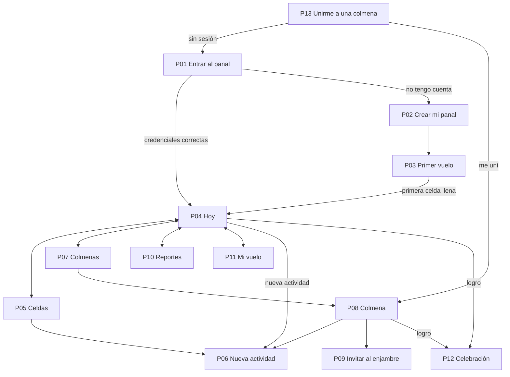

# Pantallas de Panal

Qué pantallas hay, cómo se llega a cada una, qué muestra y en qué estados puede estar. Es la especificación que se sigue al maquetar; el aspecto (colores, tipografías, medidas) está en [`../propuestas/A-panal/DESIGN.md`](../propuestas/A-panal/DESIGN.md) y [`../propuestas/A-panal/direccion-visual.md`](../propuestas/A-panal/direccion-visual.md).

La referencia visual aprobada es el tablero "Hoy" del diseño 1: [`../propuestas/A-panal/referencia/pantalla-hoy.png`](../propuestas/A-panal/referencia/pantalla-hoy.png). Las demás pantallas se diseñan con ese mismo lenguaje.

## Tabla de contenidos

1. [Mapa de la aplicación](#1-mapa-de-la-aplicación)
2. [Rutas](#2-rutas)
3. [Estructura común](#3-estructura-común)
4. [Adaptación al tamaño de pantalla](#4-adaptación-al-tamaño-de-pantalla)
5. [Estados que toda pantalla resuelve](#5-estados-que-toda-pantalla-resuelve)
6. [Pantallas](#6-pantallas)
7. [Piezas compartidas](#7-piezas-compartidas)
8. [Cambios respecto a los documentos anteriores](#8-cambios-respecto-a-los-documentos-anteriores)

## 1. Mapa de la aplicación

Hay tres zonas: **acceso** (P01, P02, P13), **recorrido inicial** (P03) y **aplicación** (el resto), que comparte cabecera y navegación.

## 2. Rutas

| Ruta | Pantalla | Requiere sesión | Notas |
| :--- | :--- | :---: | :--- |
| `/entrar` | P01 Entrar al panal | No | Con sesión, redirige a `/` |
| `/crear` | P02 Crear mi panal | No | Con sesión, redirige a `/` |
| `/primer-vuelo` | P03 Primer vuelo | Sí | Solo mientras no se haya completado |
| `/` | P04 Hoy | Sí | Página de inicio |
| `/celdas` | P05 Celdas | Sí | La pestaña va en la dirección: `/celdas?ver=proximas` |
| `/celdas/nueva`, `/celdas/:id` | P06 Nueva actividad | Sí | Se abre como ventana sobre la pantalla desde la que se llegó |
| `/colmenas` | P07 Colmenas | Sí | |
| `/colmenas/:id` | P08 Colmena | Sí | Solo integrantes |
| `/colmenas/:id/invitar` | P09 Invitar al enjambre | Sí | Ventana sobre P08 |
| `/reportes` | P10 Reportes | Sí | |
| `/mi-vuelo` | P11 Mi vuelo | Sí | Incluye ajustes |
| `/unirme/:codigo` | P13 Unirme a una colmena | No | Sin sesión, guarda el código y sigue tras entrar o registrarse |
| Cualquier otra | P14 No encontrada | No | |

P12 Celebración no tiene ruta: es una ventana que aparece cuando el store tiene logros en cola.

Las ventanas con ruta propia (P06 y P09) se pueden abrir con un enlace directo y se cierran con el botón Atrás del teléfono, que es lo que la gente espera en una aplicación instalada.

## 3. Estructura común

**Cabecera** (aplicación, en computador). A la izquierda, el hexágono y la palabra "Panal". Al centro, los cuatro destinos: Hoy, Celdas, Colmenas y Reportes; el activo va en una píldora de tinta con texto miel. A la derecha, "Nivel 4 · Exploradora" y el avatar con la inicial, que lleva a "Mi vuelo".

**Navegación inferior** (aplicación, en teléfono). Cinco posiciones: Hoy, Celdas, el botón de crear al centro, Colmenas y Reportes. Arriba queda una barra mínima con el logotipo, las gotas de hoy y el avatar.

**Contenido.** Ancho máximo de 1296 px, centrado, con margen lateral de 32 px en computador y 16 px en teléfono.

**Avisos.** Aparecen abajo, sobre la navegación, de uno en uno: confirmaciones ("Celda archivada", con "Deshacer"), errores de guardado y el aviso de versión nueva. El aviso "Sin conexión" es una franja fija bajo la cabecera mientras dure.

## 4. Adaptación al tamaño de pantalla

| Ancho | Nombre | Navegación | Rejilla de tarjetas | Ventanas |
| :--- | :--- | :--- | :--- | :--- |
| 360 a 699 px | Teléfono | Inferior | Una columna | Hoja que sube desde abajo |
| 700 a 1079 px | Tableta | Superior | Dos columnas | Centradas |
| 1080 px o más | Computador | Superior | Tres columnas | Centradas |

- Las tarjetas se adaptan al espacio que les da su contenedor, no al ancho de la ventana, para que la misma tarjeta sirva en una, dos o tres columnas.
- En teléfono, la tarjeta principal de "Hoy" apila: Zum y el saludo arriba, el panal de hoy debajo, el botón "Nueva actividad" a todo el ancho y las fichas de racha y reservas, que bajan a otra fila si no caben. Nada se oculta tras un deslizamiento.
- Zum mide 240 px en computador y 120 px en teléfono.
- La aplicación instalada respeta las zonas seguras del teléfono (muesca y barra de gestos).

## 5. Estados que toda pantalla resuelve

| Estado | Qué se ve | Regla |
| :--- | :--- | :--- |
| **Cargando por primera vez** | La silueta de la pantalla: tarjetas con su borde y bloques en lino donde irá el contenido | Nunca un indicador giratorio a pantalla completa. Si la carga dura menos de 200 ms, no se muestra nada |
| **Actualizando** | El contenido anterior, sin cambios visibles | Los datos guardados se muestran de inmediato y se refrescan por detrás |
| **Vacío** | Ilustración del panal sin miel, una frase y un botón para la acción principal | Nunca una Zum triste ni una pantalla en blanco |
| **Error al cargar** | Tarjeta con "No pudimos traer tus celdas" y el botón "Reintentar" | El resto de la pantalla sigue funcionando |
| **Error al guardar** | La acción se deshace a la vista y un aviso lo explica | Nunca se pierde lo que la persona escribió en un formulario |
| **Sin conexión** | Lo último visto, con la franja "Sin conexión" | Los botones que guardan se desactivan y explican por qué |
| **Sin permiso** | "Esta colmena es de otro enjambre", con un enlace a "Colmenas" | Para direcciones de colmenas ajenas |

## 6. Pantallas

En cada pantalla, **Datos** nombra los selectores de Redux que la alimentan y **Assets**, las ilustraciones de [`06-assets.md`](06-assets.md).

### P01. Entrar al panal

**Propósito.** Iniciar sesión. **Historias.** HU-02, HU-03.

**Contenido.**

1. Mitad izquierda en miel: Zum saluda desde la entrada de una colmena; debajo, la promesa en una línea: "Cada cosa que haces llena una celda".
2. Mitad derecha en papel: título "Entrar al panal", campos de correo y contraseña (con botón para mostrarla), botón "Entrar" y el enlace "¿No tienes panal? Crea el tuyo".

**Estados.** Enviando (botón desactivado con "Entrando…"), credenciales incorrectas (mensaje sobre el formulario, los campos conservan lo escrito), demasiados intentos (cuenta atrás en texto), sin conexión.

**Teléfono.** La mitad en miel pasa a ser una franja superior de 220 px con Zum; el formulario queda debajo.

**Datos.** `selectSesion`. **Assets.** E01.

### P02. Crear mi panal

**Propósito.** Registrarse. **Historias.** HU-01.

**Contenido.**

1. Mitad izquierda en miel: Zum sostiene una celda vacía; debajo, tres líneas con lo que se gana: "Llena celdas", "Cuida tu racha", "Suma a tu colmena".
2. Mitad derecha: título "Crear mi panal", campos de nombre, correo y contraseña; bajo la contraseña, tres celdas pequeñas que se llenan según su fuerza, con el texto correspondiente; botón "Crear mi panal" y el enlace "Ya tengo un panal".

**Estados.** Enviando, correo ya registrado (mensaje con enlace a P01), contraseña corta, sin conexión.

**Si se llegó desde una invitación,** sobre el formulario aparece "Te espera la colmena Proyecto final".

**Datos.** `selectSesion`, `selectInvitacionPendiente`. **Assets.** E02.

### P03. Primer vuelo

**Propósito.** Elegir la meta diaria y cumplir la primera actividad. **Historias.** HU-04.

**Contenido.** Tres pasos a pantalla completa, sin navegación, con tres celdas pequeñas arriba que indican el paso.

1. **"¿De qué tamaño es tu panal?"** Tres tarjetas para elegir: 3 celdas ("Tranquilo"), 5 celdas ("Constante", elegida) y 7 celdas ("Intenso"). Cada una dibuja su panal. Botón "Seguir".
2. **"Tu primera celda".** Campo de título y cuatro sugerencias que se pueden tocar ("Tomar agua", "Leer 10 minutos", "Ordenar el escritorio", "Caminar 15 minutos"). Botón "Crear celda".
3. **"Llénala".** Una celda grande con el título. Al tocarla se llena, aparecen "+10 gotas de miel", el sello "Primera celda" y "Te regalamos una reserva de miel: protege tu racha un día". Botón "Ir a mi panal".

**Estados.** Guardando cada paso; error al guardar (se queda en el paso); al volver tras salir, se retoma el paso pendiente.

**Datos.** `selectPrimerVuelo`. **Assets.** Z09 (Zum guiando), S01 (sello "Primera celda").

### P04. Hoy

**Propósito.** Ver y cumplir lo del día. Es la pantalla del diseño 1. **Historias.** HU-08, HU-09, HU-12 a HU-15, HU-17, HU-18, HU-30.

**Contenido.**

1. **Tarjeta principal en miel.** Zum en su círculo (según su estado), la fecha en mayúsculas, el saludo ("¡Buen vuelo, Ana!"), la frase del estado, el botón "Nueva actividad" y dos fichas: "Racha de vuelo: 12 días" y "2 reservas de miel". A la derecha, el panal de hoy con tantas celdas como la meta.
2. **Celdas de hoy.** Título con "3 de 5". Lista de actividades: casilla hexagonal, título, tipo y regla ("Recurrente · diaria", "Única · vence hoy"), y las gotas que vale. Las cumplidas quedan en la lista, con la casilla llena. Las vencidas llevan la etiqueta "Vencida".
3. **Colmena.** Resumen de la colmena con actividad más reciente: nombre, porcentaje, "18 de 30 celdas llenas entre 4 abejas", la rejilla de celdas y el aporte por persona. Enlaza a P08. Si hay más de una colmena, un enlace "Ver todas".
4. **Constancia.** El panal de constancia de cinco semanas, con su leyenda. Enlaza a P10.

**Estados.**

| Estado | Qué cambia |
| :--- | :--- |
| Sin actividades | La tarjeta de celdas muestra "Tu panal de hoy está por estrenar. Crea tu primera celda." con su botón |
| Sin colmenas | La tarjeta de colmena invita: "Todavía no tienes colmena. Funda una e invita a tu enjambre." |
| Panal cerrado | El panal de hoy aparece sellado, Zum celebra y el título pasa a "¡Panal cerrado, Ana!" |
| Reserva usada ayer | Franja informativa sobre la tarjeta principal, que se puede cerrar |
| Racha detenida | Franja con el mensaje sin culpa y la mejor racha |
| Día sin flores o invernada | Zum descansa; la tarjeta principal usa el tono "ala" en lugar de miel |

**Teléfono.** Una columna, en este orden: tarjeta principal, celdas de hoy, colmena, constancia.

**Datos.** `selectEstadoDeZum`, `selectPanalDeHoy`, `selectCeldasDeHoy`, `selectRacha`, `selectResumenColmenaActiva`, `selectConstancia`. **Assets.** Z01 a Z06.

### P05. Celdas

**Propósito.** Gestionar todas las actividades. **Historias.** HU-10, HU-11, HU-12.

**Contenido.**

1. Título "Celdas" y el botón "Nueva actividad".
2. Pestañas con su cantidad: "Hoy", "Próximas", "De ronda", "Archivadas".
3. Filtros en fichas: colmena y prioridad.
4. Lista. Cada fila: casilla hexagonal, título, detalle (tipo, regla o fecha, colmena), gotas y un menú con "Editar", "Posponer" y "Archivar". En "Próximas", las filas se agrupan por día. En "De ronda", cada fila muestra su cuota de la semana con celdas pequeñas ("2 de 3 esta semana").

**Estados.** Cada pestaña tiene su vacío: "No hay nada en el horizonte. Buen momento para planear la semana." (Próximas), "Todavía no tienes celdas de ronda. Son las que se repiten." (De ronda), "Aquí guardas lo que ya no necesitas ver." (Archivadas). Filtros sin resultados: "Ninguna celda coincide" y "Quitar filtros".

**Teléfono.** Las pestañas se deslizan en horizontal; el menú de cada fila se abre como hoja inferior.

**Datos.** `selectCeldasPorPestana`, `selectFiltrosDeCeldas`, `selectConteosDeCeldas`. **Assets.** E03.

### P06. Nueva actividad

**Propósito.** Crear o editar una actividad. **Historias.** HU-06, HU-07, HU-10, HU-23.

**Contenido.** Ventana con el título "Nueva actividad" o "Editar actividad".

1. Campo de título.
2. Selector de dos opciones: "Única" y "De ronda".
3. Si es única: fecha (opcional) y el interruptor "Prioridad alta".
4. Si es de ronda: cuatro opciones ("Todos los días", "Ciertos días", "Veces por semana", "Día del mes") y, según la elegida, siete fichas con los días, un contador de 1 a 6 o un selector de día. Debajo, la regla en palabras.
5. Colmena (opcional) y, si se elige una, "Asignar a" con el enjambre y la opción "Libre".
6. Vista previa: "Esta celda vale +25 gotas de miel".
7. Botones "Guardar" y "Cancelar". Al editar, además, "Archivar".

**Estados.** Título vacío (el botón no envía y el campo lo indica), límite de prioridad alta alcanzado (el interruptor se desactiva con explicación), guardando, error al guardar (la ventana sigue abierta con lo escrito), cierre con cambios sin guardar (pide confirmación).

**Teléfono.** Ocupa toda la pantalla, con "Guardar" fijo abajo.

**Datos.** `selectBorradorDeCelda`, `selectColmenasParaElegir`, `selectVistaPreviaDeGotas`. **Assets.** Ninguno.

### P07. Colmenas

**Propósito.** Ver los proyectos propios. **Historias.** HU-20.

**Contenido.**

1. Título "Colmenas" y el botón "Fundar una colmena".
2. Una tarjeta por colmena activa: nombre, colmena en miniatura (la rejilla en pequeño), porcentaje, cuadro actual, avatares del enjambre y fecha de entrega ("Faltan 9 días").
3. "El colmenar": las colmenas cerradas, como tarros con su nombre.

"Fundar una colmena" abre una ventana con nombre, descripción y fecha de entrega.

**Estados.** Sin colmenas: "Todavía no tienes colmena. Funda una e invita a tu enjambre." Sin colmenas cerradas, el colmenar no se muestra.

**Datos.** `selectColmenasActivas`, `selectColmenar`. **Assets.** E04.

### P08. Colmena

**Propósito.** Seguir un proyecto: cuánto falta y quién aportó. **Historias.** HU-23 a HU-28, HU-33.

**Contenido.**

1. Encabezado: nombre, fecha de entrega, porcentaje grande, y los botones "Invitar al enjambre" y "Nueva celda".
2. **La colmena.** La rejilla grande, una celda por actividad, en cinco filas rotuladas con su cuadro. Las llenas, con el color y la inicial de quien las llenó. Debajo: "Cuadro 3 de 5. Faltan 6 celdas para el cuarto". Al lado, la ilustración de la colmena en la etapa que corresponde.
3. **El enjambre.** Una fila por integrante: color, nombre, celdas aportadas y celdas asignadas pendientes.
4. **Celdas de la colmena.** Lista con pestañas "Pendientes", "Mías", "Libres" y "Llenas". Cada fila muestra a quién está asignada.
5. Menú de la colmena: "Editar", "Salir de la colmena" y, para la fundadora, "Archivar".

**Estados.** Colmena sin celdas ("Esta colmena está vacía. Crea su primera celda."), enjambre de una sola persona (invita a sumar gente), colmena cerrada (solo lectura, con su sello), sin permiso.

**Teléfono.** La rejilla se ajusta al ancho reduciendo el tamaño de las celdas; con más de 40 celdas se puede deslizar en horizontal.

**Datos.** `selectColmena`, `selectAvanceDeColmena`, `selectAportePorPersona`, `selectCeldasDeColmena`. **Assets.** H01 a H05.

### P09. Invitar al enjambre

**Propósito.** Vincular personas. **Historias.** HU-21, HU-29.

**Contenido.** Ventana sobre P08.

1. Título "Invitar al enjambre" y una línea: "Quien abra este enlace podrá unirse a Proyecto final".
2. El enlace, con los botones "Copiar" y, en teléfono, "Compartir".
3. "Vence en 7 días" y el enlace "Anular y crear otro".
4. Lista "Ya en el enjambre", con la fecha en que se unió cada persona.

**Estados.** Copiado (el botón dice "Copiado" dos segundos), creando el enlace, error.

**Datos.** `selectInvitacionDeColmena`, `selectEnjambre`. **Assets.** Z07.

### P10. Reportes

**Propósito.** Entender el progreso con gráficas. **Historias.** HU-30 a HU-34.

**Contenido.**

1. Título "Reportes" y tres cifras: celdas de la semana, racha de vuelo actual y mejor racha.
2. **Panal de constancia**, grande, con su frase y su leyenda.
3. **Celdas por día**: columnas de la semana, con su frase y la comparación con la semana anterior.
4. **Tus rondas**: una tira de siete celdas por actividad de ronda, con su porcentaje.
5. **Únicas y de ronda**: dos tarros que se llenan en proporción.
6. **Tus colmenas**: por cada una, el aporte de cada integrante.

Cada gráfica tiene título, una frase que la resume y el enlace "Ver como tabla".

**Estados.** Sin datos: "Aquí aparecerá tu panal de constancia cuando llenes tu primera celda." Con menos de una semana de uso, las gráficas de semana muestran solo los días que hay, sin ceros inventados.

**Datos.** `selectConstancia`, `selectCeldasPorDia`, `selectCumplimientoPorRonda`, `selectRepartoPorTipo`, `selectAportePorColmena`. **Assets.** E03.

### P11. Mi vuelo

**Propósito.** Ver el nivel, las insignias y cambiar ajustes. **Historias.** HU-16, HU-35 a HU-38.

**Contenido.**

1. Retrato de Zum, nombre, "Nivel 4 · Exploradora" y el total de gotas.
2. **Escalera de oficios**: diez celdas, llenas hasta el oficio actual, con la barra "Faltan 60 gotas para Recolectora".
3. **Sellos de cera**: rejilla con los ganados y los que faltan en hueco; al tocar uno se ven su criterio y su progreso.
4. **Alacena de mieles** (versión 1.1).
5. **Ajustes**: tamaño del panal, día sin flores, invernada, zona horaria, reducir animaciones, "Instalar Panal", "Cómo se ganan las gotas" y "Cerrar sesión".

**Estados.** Sin sellos todavía (todos en hueco, con el primero resaltado como siguiente meta), guardando un ajuste, error.

**Datos.** `selectOficio`, `selectSellos`, `selectAjustes`, `selectPuedeInstalar`. **Assets.** Z01, S01 a S17.

### P12. Celebración

**Propósito.** Reconocer un logro. **Historias.** HU-14, HU-17, HU-19, HU-25.

**Contenido.** Ventana con Zum celebrando, el título del logro, lo ganado en fichas ("+20 gotas de miel", "Racha de vuelo: 13 días"), la siguiente meta en una línea y el botón "Seguir".

| Logro | Título | Dibujo bajo Zum |
| :--- | :--- | :--- |
| Panal cerrado | ¡Panal cerrado! | El panal de hoy sellado |
| Nuevo oficio | ¡Nuevo oficio: Recolectora! | La escalera con la celda nueva |
| Sello ganado | Nuevo sello de cera: Semana de vuelo | El sello |
| Cuadro de colmena | ¡La colmena cerró su cuarto cuadro! | La colmena en su nueva etapa |
| Colmena cerrada | ¡Enjambrazón! | El enjambre en vuelo |

**Reglas.** Si hay varios logros en cola se muestran juntos, del más grande al más pequeño. Se cierra con el botón, con Escape o tocando fuera. Con movimiento reducido no hay animación.

**Datos.** `selectColaDeCelebraciones`. **Assets.** Z04, E05, y el sello que corresponda.

### P13. Unirme a una colmena

**Propósito.** Aceptar una invitación por enlace. **Historias.** HU-22.

**Contenido.** Tarjeta centrada: Zum en la entrada de una colmena, "Sofía te invita a la colmena Proyecto final", cuántas abejas tiene y el botón "Unirme". Sin sesión, los botones son "Crear mi panal" y "Ya tengo un panal".

**Estados.** Comprobando el enlace, invitación vencida o anulada ("Esta invitación ya no está activa. Pide a tu enjambre un enlace nuevo."), ya soy integrante (redirige a la colmena).

**Datos.** `selectInvitacionPendiente`. **Assets.** Z07.

### P14. No encontrada y sin conexión

**Propósito.** Que un tropiezo no parezca una avería.

- **No encontrada.** "Esta celda no existe. Volvamos al panal.", con el botón "Ir a Hoy".
- **Sin conexión y sin datos guardados.** "Panal necesita conexión la primera vez. Vuelve a intentarlo cuando tengas señal.", con el botón "Reintentar".

**Assets.** E06.

## 7. Piezas compartidas

Las pantallas se arman con un conjunto pequeño de piezas. Todas son componentes propios, sin librería de interfaz.

| Pieza | Qué es | Dónde se usa |
| :--- | :--- | :--- |
| `Zum` | La mascota en uno de sus estados y tamaños | P01 a P04, P09, P11 a P14 |
| `Hexagono` | La celda: vacía, llena, sellada, con inicial o punteada | Todas las gráficas |
| `CasillaHexagonal` | La casilla para llenar una celda; es un control accesible | P03, P04, P05, P08 |
| `PanalDeHoy` | El panal de 3, 5 o 7 celdas | P03, P04, P12 |
| `RejillaDeColmena` | Una celda por actividad, en cinco filas | P04, P07, P08 |
| `PanalDeConstancia` | El mapa de cinco semanas | P04, P10 |
| `TiraDeCeldas`, `Columnas`, `Tarros`, `EscaleraDeOficios` | Las demás gráficas | P10, P11 |
| `Tarjeta` | Fondo blanco, borde de tinta, sombra dura | Todas |
| `Boton`, `Ficha`, `Pestanas`, `Campo`, `Interruptor` | Controles | Todas |
| `Ventana` | Ventana centrada u hoja inferior, sobre el elemento nativo de diálogo | P06, P09, P12 |
| `FilaDeCelda` | La fila de una actividad en una lista | P04, P05, P08 |
| `Aviso`, `FranjaDeEstado` | Avisos temporales y franjas | Todas |
| `EstadoVacio`, `Silueta` | Vacíos y carga | Todas |
| `SelloDeCera` | Un sello ganado o en hueco | P03, P11, P12 |

## 8. Cambios respecto a los documentos anteriores

- **Dos pantallas nuevas.** P13 "Unirme a una colmena" y P14 "No encontrada y sin conexión" no estaban en el inventario de doce. Salen de la invitación por enlace y de la PWA.
- **La invitación principal es por enlace.** El correo pasa a la versión 1.1; por eso P09 ya no tiene un campo de correo en la versión 1.
- **"Fundar una colmena" es una ventana de P07**, no una pantalla aparte.
- **Los ajustes viven en P11**, incluida la opción de instalar la aplicación.
- **Vocabulario.** Se usa el de la propuesta escrita: "Racha de vuelo" y "reservas de miel" (el tablero del lienzo decía "Racha de 12 días" y "2 escudos").
