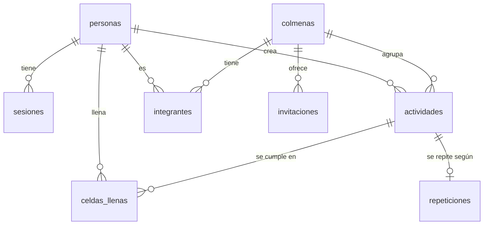

# Datos y API de Panal

Qué se guarda, qué se calcula y cómo conversan el navegador y el servidor. Las razones del stack están en [`04-stack-y-arquitectura.md`](04-stack-y-arquitectura.md).

Estado: **diseño, sin implementar**. Los nombres pueden ajustarse al construir.

## Tabla de contenidos

1. [Principio: se guardan hechos, se calcula el resto](#1-principio-se-guardan-hechos-se-calcula-el-resto)
2. [Modelo de datos](#2-modelo-de-datos)
3. [Tablas](#3-tablas)
4. [El día lógico](#4-el-día-lógico)
5. [El motor: funciones puras](#5-el-motor-funciones-puras)
6. [El store de Redux](#6-el-store-de-redux)
7. [API](#7-api)
8. [Reglas de permisos](#8-reglas-de-permisos)
9. [Plan de pruebas](#9-plan-de-pruebas)

## 1. Principio: se guardan hechos, se calcula el resto

En la base solo hay **hechos**: quién llenó qué celda y qué día. Las gotas, el oficio, la racha, las reservas, los cuadros de una colmena y los sellos **no tienen columna**: se calculan con funciones puras a partir de esos hechos.

| Se guarda | Se calcula al leer |
| :--- | :--- |
| Personas, actividades y sus reglas de repetición | Qué actividades tocan hoy |
| Celdas llenas: actividad, persona, día e instante | Gotas de cada celda y total de gotas |
| Colmenas, integrantes e invitaciones | Oficio, racha de vuelo, mejor racha y reservas |
| Ajustes: meta diaria, día sin flores, invernada | Panal de hoy, panal cerrado y estado de Zum |
| | Avance de la colmena, cuadros y aporte por persona |
| | Sellos de cera ganados y su progreso |

**Por qué.** Nada se desincroniza: deshacer una celda es borrar un hecho y todo lo demás se recalcula solo. Cambiar una regla del juego se aplica hacia atrás sin migrar datos. No hace falta ningún proceso programado. Y es la idea central de la materia: el estado es el resultado de reducir una lista de hechos.

**Un caso límite conocido.** Si a una colmena se le agregan celdas después de alcanzar un cuadro, el porcentaje baja y ese cuadro puede volver a abrirse, con lo que sus gotas se retiran hasta alcanzarlo otra vez. Es coherente con la regla, pero puede sentirse injusto. La propuesta es avisarlo antes de guardar ("Al agregar esta celda, el cuarto cuadro vuelve a abrirse") y revisarlo al probar con usuarios.

**El costo.** Calcular al leer cuesta más que leer una columna. A la escala de un proyecto universitario (unas pocas miles de celdas por persona) es despreciable. Si creciera, se guarda un resumen por persona que se recalcula al escribir; el motor no cambia.

## 2. Modelo de datos



Son ocho tablas. Las tablas `eventos` e `insignias_usuario` de la propuesta base desaparecen: los hechos ya están en `celdas_llenas` y los sellos se calculan.

## 3. Tablas

Todas las claves primarias son identificadores `uuid`. Los que crea el navegador (actividades y celdas llenas) permiten repetir un envío sin duplicar nada.

### `personas`

| Columna | Tipo | Notas |
| :--- | :--- | :--- |
| `id` | `uuid` | Clave primaria |
| `nombre` | `text` | De 1 a 40 caracteres |
| `correo` | `text` | Único, en minúsculas |
| `clave_hash` | `text` | `scrypt` con sal propia; nunca sale de la API |
| `meta_diaria` | `smallint` | 3, 5 o 7 |
| `meta_siguiente` | `smallint` | Cambio pendiente; rige desde el día siguiente |
| `zona_horaria` | `text` | Nombre IANA; por defecto `America/La_Paz` |
| `dia_sin_flores` | `smallint` | De 1 (lunes) a 7 (domingo), o nulo |
| `invernada_desde`, `invernada_hasta` | `date` | Pausa en curso, o nulos |
| `primer_vuelo_en` | `timestamptz` | Nulo hasta completar el recorrido inicial |
| `creada_en` | `timestamptz` | |

### `sesiones`

| Columna | Tipo | Notas |
| :--- | :--- | :--- |
| `id_hash` | `text` | Clave primaria. Se guarda el hash del identificador, no el identificador |
| `persona_id` | `uuid` | |
| `creada_en`, `vence_en` | `timestamptz` | 30 días, renovables con el uso |

### `actividades`

| Columna | Tipo | Notas |
| :--- | :--- | :--- |
| `id` | `uuid` | Lo crea el navegador |
| `creada_por` | `uuid` | |
| `colmena_id` | `uuid` | Nulo si es personal |
| `asignada_a` | `uuid` | Nulo si es personal o si está libre |
| `titulo` | `text` | De 1 a 80 caracteres |
| `tipo` | `text` | `unica` o `ronda` |
| `prioridad_alta` | `boolean` | Solo en únicas |
| `vence_el` | `date` | Solo en únicas; puede ser nulo |
| `archivada_en` | `timestamptz` | Nulo si está activa |
| `creada_en` | `timestamptz` | Sirve para la regla de actividades relámpago |

### `repeticiones`

Una fila por actividad de ronda.

| Columna | Tipo | Notas |
| :--- | :--- | :--- |
| `actividad_id` | `uuid` | Clave primaria |
| `clase` | `text` | `diaria`, `dias_semana`, `veces_semana` o `dia_mes` |
| `dias_semana` | `smallint[]` | De 1 a 7; solo para `dias_semana` |
| `veces` | `smallint` | De 1 a 6; solo para `veces_semana` |
| `dia_mes` | `smallint` | De 1 a 31; solo para `dia_mes` |
| `desde` | `date` | Día lógico desde el que rige |

### `celdas_llenas`

El registro de hechos. Es la tabla más importante.

| Columna | Tipo | Notas |
| :--- | :--- | :--- |
| `id` | `uuid` | Lo crea el navegador |
| `actividad_id` | `uuid` | |
| `persona_id` | `uuid` | Quien la llenó |
| `dia` | `date` | **Día lógico**, calculado por el servidor (ver sección 4) |
| `llenada_en` | `timestamptz` | Instante real |

Restricción única en (`actividad_id`, `dia`): una actividad se llena una sola vez por día, sea quien sea. Para una única, además, solo puede existir una fila.

### `colmenas`

| Columna | Tipo | Notas |
| :--- | :--- | :--- |
| `id` | `uuid` | |
| `nombre` | `text` | De 1 a 60 caracteres |
| `descripcion` | `text` | Opcional |
| `fundadora_id` | `uuid` | |
| `entrega_el` | `date` | Opcional |
| `cerrada_en` | `timestamptz` | Se fija al llegar al 100 % |
| `archivada_en` | `timestamptz` | |

### `integrantes`

| Columna | Tipo | Notas |
| :--- | :--- | :--- |
| `colmena_id`, `persona_id` | `uuid` | Clave primaria compuesta |
| `color` | `smallint` | Posición en la paleta de integrantes, por orden de llegada |
| `unida_en` | `timestamptz` | |
| `salio_en` | `timestamptz` | Nulo mientras siga dentro; sus celdas llenas se conservan |

### `invitaciones`

| Columna | Tipo | Notas |
| :--- | :--- | :--- |
| `codigo_hash` | `text` | Clave primaria. El código solo viaja en el enlace |
| `colmena_id` | `uuid` | |
| `creada_por` | `uuid` | |
| `vence_en` | `timestamptz` | 7 días |
| `anulada_en` | `timestamptz` | |

**Índices.** `celdas_llenas (persona_id, dia)` para el día y los reportes; `celdas_llenas (actividad_id)`; `actividades (creada_por)`, `actividades (asignada_a)` y `actividades (colmena_id)`.

## 4. El día lógico

El día de Panal cambia a las 03:00 de la zona horaria de cada persona. Es la fuente de errores más probable del proyecto, así que la regla está en un solo lugar.

- **Una sola función pura** del motor lo calcula: `diaLogico(instante, zonaHoraria)` devuelve una fecha. Las 02:30 del sábado pertenecen al viernes.
- **El servidor es la autoridad.** Al llenar una celda calcula el día con su propio reloj y lo guarda en `celdas_llenas.dia`. El navegador no puede elegir el día.
- **Todo lo demás trabaja con fechas, no con instantes.** La racha, la constancia y los reportes agrupan por `dia`; ninguna consulta vuelve a convertir zonas horarias.
- **El motor no lee el reloj.** Todas sus funciones reciben "hoy" como dato. Por eso se pueden probar con cualquier fecha.

## 5. El motor: funciones puras

Vive en `packages/motor`, sin dependencias, y lo usan el servidor (como autoridad) y el navegador (para responder al instante).

| Función | Recibe | Devuelve |
| :--- | :--- | :--- |
| `diaLogico(instante, zona)` | Un instante y una zona horaria | El día al que pertenece |
| `ocurrencias(regla, desde)` | Una regla de repetición y un día | Un **generador** con los días en que toca, sin límite |
| `tocaHoy(actividad, regla, hechos, hoy)` | Una actividad y su contexto | Si aparece hoy, y si está vencida |
| `gotasDeCelda(celda, contexto)` | Una celda llena y lo que pasó ese día | Sus gotas, aplicando los límites contra el abuso |
| `resumenDelDia(hechos, ajustes, dia)` | Los hechos de un día | Celdas llenas, meta, si el panal cerró y gotas del día |
| `rachaDe(dias, ajustes, hoy)` | Los días con actividad | Racha actual, mejor racha, reservas y reservas usadas |
| `oficioDe(gotas)` | Un total de gotas | Nivel, nombre del oficio y gotas que faltan |
| `avanceDeColmena(celdas)` | Las celdas de una colmena, cada una con quién la llenó | Porcentaje, cuadro actual, faltan para el siguiente y aporte por persona |
| `sellosDe(historial)` | El historial completo | Sellos ganados con su fecha y progreso de los demás |
| `estadoDeZum(resumen, racha, ahora)` | El día y la racha | Uno de los seis estados |
| `celebracionesEntre(antes, despues)` | Dos resúmenes | Los logros nuevos, para mostrarlos |

`celebracionesEntre` es lo que permite que el servidor responda a "llené una celda" con todo lo que se ganó, sin guardar nada más: compara el resumen de antes con el de después.

**Estado al 13 de noviembre de 2026.** Están escritas y probadas las que usa la pantalla "Hoy": `diaLogico`, `tocaHoy`, `gotasDeCelda`, `resumenDelDia`, `rachaDe`, `oficioDe`, `avanceDeColmena`, `estadoDeZum` y, además, `constanciaDe`, que agrupa las celdas por día para el panal de constancia. Faltan `ocurrencias`, `sellosDe` y `celebracionesEntre`. A `rachaDe` le falta gastar sola una reserva cuando un día programado queda en cero: por ahora recibe las reservas ya contadas.

## 6. El store de Redux

Sigue la estructura del ejemplo de clase: `app/store.js` y una carpeta por funcionalidad con su slice, sus selectores y su hook.

```
store
├── api            RTK Query: caché de todo lo que viene del servidor
├── sesion         quién soy, estado del inicio de sesión, invitación pendiente
├── interfaz       ventana abierta, pestaña y filtros de cada lista, avisos
├── celebraciones  cola de logros por mostrar
├── borradores     formularios a medio escribir (nueva actividad, nueva colmena)
├── primerVuelo    paso actual del recorrido inicial
├── conexion       con o sin red, versión nueva disponible, se puede instalar
└── reloj          la hora actual, para que los selectores no la lean por su cuenta
```

Hoy existen `api` y `reloj`; los demás se suman con sus pantallas.

**Qué va en cada lado.**

| | RTK Query (`api`) | Slices propios |
| :--- | :--- | :--- |
| Qué guarda | Lo que es verdad en el servidor: actividades, celdas llenas, colmenas, perfil | Lo que solo existe en esta pantalla |
| Quién lo cambia | Las respuestas del servidor y las actualizaciones optimistas | Las acciones de la persona |
| Ejemplo | La lista de celdas de hoy | Qué pestaña estoy mirando |

**Selectores derivados.** Las pantallas no calculan nada: leen selectores memorizados que combinan el caché de la API con el motor.

| Selector | Combina | Lo usa |
| :--- | :--- | :--- |
| `selectCeldasDeHoy` | Actividades, celdas llenas y `tocaHoy` | P04, P05 |
| `selectPanalDeHoy` | `resumenDelDia` | P04, P12 |
| `selectRacha` | `rachaDe` | P04, P10, P11 |
| `selectOficio` | `oficioDe` | Cabecera, P11 |
| `selectEstadoDeZum` | `estadoDeZum` sobre los tres anteriores | P04 |
| `selectAvanceDeColmena(id)` | `avanceDeColmena` | P04, P07, P08 |
| `selectConstancia` | Celdas llenas agrupadas por día | P04, P10 |
| `selectSellos` | `sellosDe` | P11 |

**Llenar una celda, paso a paso.**

1. La persona toca la casilla. El componente despacha la mutación `llenarCelda`.
2. Antes de que el servidor responda, la mutación agrega la celda al caché. Los selectores se recalculan y la pantalla cambia: la casilla, el panal de hoy, las gotas y Zum.
3. El servidor guarda el hecho, calcula con el motor y responde con las celebraciones.
4. Un *listener* escucha esa respuesta y pone los logros en la cola de `celebraciones`. Aparece la ventana.
5. Si el servidor falla, la mutación deshace el cambio del paso 2 y despacha un aviso.

Los reducers no hacen nada de esto: los efectos viven en la mutación y en el *listener*.

## 7. API

REST con JSON, bajo `/api`. La sesión viaja en una cookie; no hay cabeceras de autorización. Los cuerpos se validan con los esquemas Zod de `packages/contratos`, los mismos que usa el navegador.

### Cuenta

| Método y ruta | Uso | Respuesta |
| :--- | :--- | :--- |
| `POST /api/cuenta` | Registrarse | 201 con el perfil; deja la cookie |
| `POST /api/sesion` | Entrar | 200 con el perfil; deja la cookie |
| `DELETE /api/sesion` | Cerrar sesión | 204 |
| `GET /api/yo` | Perfil y ajustes | 200, o 401 sin sesión |
| `PATCH /api/yo` | Cambiar nombre, meta, zona horaria, día sin flores o invernada | 200 |
| `POST /api/yo/primer-vuelo` | Terminar el recorrido inicial | 200 |

### Actividades y celdas

| Método y ruta | Uso | Respuesta |
| :--- | :--- | :--- |
| `GET /api/panal` | Todo lo necesario para "Hoy" en una sola llamada: actividades activas, celdas llenas de las últimas cinco semanas y resumen | 200 |
| `GET /api/actividades?ver=` | Listas de "Celdas": próximas, de ronda o archivadas | 200 |
| `PUT /api/actividades/:id` | Crear o reemplazar. El identificador lo pone el navegador | 200 o 201 |
| `PATCH /api/actividades/:id` | Editar, posponer, archivar o recuperar | 200 |
| `PUT /api/celdas/:id` | Llenar una celda. Cuerpo: la actividad. El servidor calcula el día | 200 con las gotas y las celebraciones |
| `DELETE /api/celdas/:id` | Deshacer | 204 |

### Colmenas

| Método y ruta | Uso | Respuesta |
| :--- | :--- | :--- |
| `GET /api/colmenas` | Mis colmenas, con su avance | 200 |
| `POST /api/colmenas` | Fundar | 201 |
| `GET /api/colmenas/:id` | Detalle: enjambre, celdas y avance | 200, o 403 si no soy integrante |
| `PATCH /api/colmenas/:id` | Editar o archivar | 200 |
| `POST /api/colmenas/:id/invitacion` | Crear el enlace, o anular el actual y crear otro | 201 con el código |
| `GET /api/invitaciones/:codigo` | Ver a qué colmena invita | 200, o 410 si venció |
| `POST /api/invitaciones/:codigo/aceptar` | Unirme | 200 con la colmena |
| `DELETE /api/colmenas/:id/integrantes/:personaId` | Salir o quitar a alguien | 204 |

### Reportes

| Método y ruta | Uso | Respuesta |
| :--- | :--- | :--- |
| `GET /api/reportes?desde=&hasta=` | Celdas por día, cumplimiento por ronda, reparto por tipo y aporte por colmena | 200 |

### Convenciones

- **Repetir es seguro.** Crear una actividad y llenar una celda usan `PUT` con un identificador creado en el navegador: si el mismo envío llega dos veces, la segunda no cambia nada.
- **Errores.** Siempre con la misma forma: `{ "error": { "codigo": "correo_en_uso", "mensaje": "Ese correo ya tiene un panal." } }`. El navegador decide qué mostrar según `codigo`.
- **Códigos.** 400 datos inválidos, 401 sin sesión, 403 sin permiso, 404 no existe, 409 conflicto (por ejemplo, celda ya llena por otra persona), 410 invitación vencida, 429 demasiados intentos.
- **Una llamada por pantalla.** `GET /api/panal` evita que "Hoy" haga cinco peticiones en un teléfono con mala señal.

## 8. Reglas de permisos

Se comprueban en el servidor, en una sola capa, antes de tocar la base.

| Recurso | Quién puede verlo | Quién puede cambiarlo |
| :--- | :--- | :--- |
| Actividad personal | Quien la creó | Quien la creó |
| Actividad de una colmena | Integrantes | Integrantes |
| Llenar una celda de colmena | | Su persona asignada, o cualquier integrante si está libre |
| Deshacer una celda | | Solo quien la llenó |
| Colmena | Integrantes | Editar: integrantes. Archivar y quitar integrantes: la fundadora |
| Invitación | Cualquiera con el enlace: ve el nombre de la colmena y de quien invita | Crear y anular: integrantes |
| Perfil | La propia persona. Los integrantes de una misma colmena se ven el nombre y el color, nunca el correo | La propia persona |

## 9. Plan de pruebas

| Nivel | Qué se prueba | Con qué |
| :--- | :--- | :--- |
| **Motor** | Cada función con ejemplos y con **propiedades**: deshacer una celda deja el resumen como estaba; las gotas nunca son negativas; la racha nunca supera los días transcurridos; `ocurrencias` nunca devuelve un día anterior a `desde`; el día lógico de las 02:59 es el anterior | Vitest y fast-check |
| **Reducers y selectores** | Cada slice con sus acciones; los selectores con estados de ejemplo | Vitest |
| **API** | Cada ruta contra una base nueva en memoria: caso feliz, datos inválidos, sin sesión y sin permiso | Vitest, `app.request()` y PGlite |
| **Componentes** | Las piezas con lógica propia: casilla hexagonal, formulario de actividad, ventana | Vitest en modo navegador |
| **Recorrido completo** | El recorrido de "Cuándo está terminado" del PRD, a mano, en computador y en teléfono | Lista de comprobación |

El orden de construcción sigue este mismo orden: primero el motor con sus pruebas, que no depende de nada.
