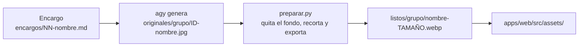

# Assets de Panal

Qué ilustraciones necesita la aplicación, dónde va cada una y cómo se generan con `agy`. Las pantallas que las usan están en [`03-pantallas.md`](03-pantallas.md).

## Tabla de contenidos

1. [Qué se genera y qué se dibuja en código](#1-qué-se-genera-y-qué-se-dibuja-en-código)
2. [Cómo trabaja agy](#2-cómo-trabaja-agy)
3. [Del original al asset listo](#3-del-original-al-asset-listo)
4. [Carpetas](#4-carpetas)
5. [Inventario](#5-inventario)
6. [Reglas de estilo de todo encargo](#6-reglas-de-estilo-de-todo-encargo)
7. [Iconos de la aplicación instalada](#7-iconos-de-la-aplicación-instalada)
8. [Textos alternativos](#8-textos-alternativos)
9. [Estado](#9-estado)

## 1. Qué se genera y qué se dibuja en código

No todo lo que se ve es una imagen. La regla: **se genera lo que es ilustración; se dibuja en código lo que representa datos o se repite con variaciones**.

| Se genera con el modelo de imágenes | Se dibuja en código (SVG y CSS) |
| :--- | :--- |
| Zum en sus estados y poses | Hexágonos y celdas en todos sus estados |
| Escenas: acceso, estados vacíos, enjambrazón, no encontrada | Todas las gráficas: panal de hoy, colmena, constancia, tiras, columnas, escalera |
| Las cinco etapas de la colmena | Los tarros de miel: una sola forma con 14 colores |
| Los sellos de cera | Iconos de interfaz, de trazo fino |
| El icono de la aplicación | Logotipo, botones, fichas, tarjetas |

**Por qué las gráficas no se generan.** Cambian con los datos, tienen que verse nítidas a cualquier tamaño, se animan celda por celda y deben poder leerse con un lector de pantalla. Una imagen fija no puede hacer nada de eso.

**Por qué los tarros no se generan.** Son catorce variaciones de un mismo objeto: catorce imágenes generadas saldrían distintas entre sí. Una forma en SVG con el color como variable sale idéntica y pesa casi nada.

## 2. Cómo trabaja agy

Comprobado el 13 de noviembre de 2026 con `agy` 1.5.7.

- **Modelo.** `gemini-4-hydrogen-xhigh`. Hydrogen no dibuja: dirige a un subagente generador de imágenes, revisa cada resultado contra el encargo y pide correcciones. La hoja de personaje pasó por varias rondas de revisión antes de darse por buena.
- **Qué entrega.** JPEG de 1024 × 1024 px en formato cuadrado y de 1264 × 848 px en 3:2. La herramienta solo deja elegir la proporción, no la resolución. **No entrega transparencia**: el fondo se quita después, en local.
- **Cuánto tarda.** Entre tres y cuatro minutos por imagen, contando la revisión. Por eso cada sesión lleva como máximo tres imágenes y los lotes se reparten en sesiones paralelas.
- **La cuota de imágenes es limitada.** El generador usa el modelo `gemini-3.1-flash-image`, con una cuota propia que se agotó tras unas doce generaciones y tarda cerca de cinco horas en restablecerse. Hydrogen en XHigh es perfeccionista: hizo cuatro versiones de la hoja y tres de una pose. Por eso los encargos piden ahora una sola generación por imagen y repetir solo si se incumple un rasgo obligatorio.
- **Dónde lo deja.** En su carpeta interna (`~/.gemini/antigravity-cli/brain/<conversación>/`). Para dejarlo en la carpeta del proyecto necesita ejecutar un comando de copia.
- **Permisos.** En modo no interactivo, `agy` no puede pedir permiso para ejecutar comandos y los deniega. Por eso se lanza con `--dangerously-skip-permissions`, que tú autorizaste. Para acotarlo, se ejecuta con `assets-fuente/` como carpeta de trabajo (no ve el resto del proyecto) y cada encargo limita los comandos a crear carpetas y copiar archivos. En el registro de las sesiones, el único comando que ejecutó fue `Copy-Item` hacia la ruta pedida.

**Cómo se lanza un encargo.**

```bash
cd assets-fuente
agy -p "$(cat encargos/01-estados-de-zum.md)" \
    --model gemini-4-hydrogen-xhigh \
    --dangerously-skip-permissions \
    --output-format stream-json --print-timeout 1800s > registro.jsonl
```

Cada encargo es un archivo de `assets-fuente/encargos/`: dice qué referencias mirar, qué generar, con qué estilo y **en qué ruta exacta dejar cada imagen**.

**Orden obligado.** Primero la hoja de personaje (encargo 00). Los demás encargos la usan como referencia para que Zum sea la misma en todas las imágenes.

## 3. Del original al asset listo



`assets-fuente/herramientas/preparar.py` hace cuatro cosas con cada original:

1. Detecta el color de fondo en el borde de la imagen y lo vuelve transparente. Solo quita el fondo que toca el borde, así el brillo blanco de los ojos se conserva.
2. Suaviza el contorno y le quita el halo del fondo.
3. Recorta y centra el dibujo en un lienzo cuadrado, con un 6 % de margen.
4. Exporta en WebP a los tamaños pedidos, más un PNG maestro.

```bash
python herramientas/preparar_todo.py          # todo lo que ya tenga original
python herramientas/preparar_todo.py Z03 Z05  # solo esos
```

`preparar_todo.py` lee `herramientas/inventario.csv`, que dice para cada identificador su carpeta, su nombre final y sus tamaños. Para un archivo suelto, o para sacar una pose de una hoja con `--recorte 0.66,0,1,0.5`, se usa `preparar.py` directamente.

**Probado** con las poses ya generadas: sobre el círculo de cera clara, sobre blanco y sobre el color miel de la tarjeta principal el recorte queda limpio, y a 64 px Zum se sigue leyendo. Sobre fondo de tinta se nota un filo claro muy fino; no afecta, porque Zum siempre va sobre fondos claros.

**Límite conocido.** Si una pose deja fondo encerrado (por ejemplo, entre un brazo en jarra y el cuerpo), ese hueco queda blanco. Los encargos piden evitarlo; si aparece, se regenera esa imagen.

## 4. Carpetas

```
assets-fuente/
├── referencia/       el Zum original y la pantalla Hoy del diseño 1, para que el modelo los mire
├── encargos/         un archivo por lote: lo que se le pide a agy
├── originales/       lo que deja agy, sin tocar
│   ├── zum/  escenas/  colmena/  sellos/  icono/
├── listos/           recortados, con transparencia y en sus tamaños finales
└── herramientas/     preparar.py, preparar_todo.py e inventario.csv
```

Cuando exista la aplicación, el contenido de `listos/` se copia a `apps/web/src/assets/` y los iconos, a `apps/web/public/`. `originales/` no se publica.

## 5. Inventario

Tamaños en píxeles del archivo WebP; el mayor cubre pantallas de alta densidad. **Lote** indica el orden de generación.

### Zum

| ID | Archivo final | Qué muestra | Dónde se usa | Tamaños | Lote |
| :--- | :--- | :--- | :--- | :--- | :---: |
| Z00 | No se publica | Hoja de personaje con los seis estados | Referencia para los demás encargos | | 0 |
| Z01 | `zum/esperando` | De frente, quieta, sonrisa pequeña | P04 sin celdas llenas, P11 retrato | 720, 360, 128 | 1 |
| Z02 | `zum/animando` | Inclinada, señalando con un bracito | P04 con una celda llena | 720, 360, 128 | 1 |
| Z03 | `zum/feliz` | En vuelo, sonrisa amplia | P04 con la mitad o más | 720, 360, 128 | 1 |
| Z04 | `zum/celebrando` | Bracitos en alto, ojos en arco, tres gotas | P04 con el panal cerrado, P12 | 720, 360, 128 | 1 |
| Z05 | `zum/preocupada` | Alas bajas, cejas levantadas | P04 de tarde, sin celdas y con racha en juego | 720, 360, 128 | 1 |
| Z06 | `zum/descansando` | Dormida, alas plegadas | P04 en día sin flores o invernada | 720, 360, 128 | 1 |
| Z07 | `zum/saludando` | Un bracito en alto, saludando | P09, P13 | 720, 360 | 2 |
| Z08 | `zum/con-flor` | Sostiene una flor de cinco pétalos | P12 al encontrar una flor rara (versión 1.1) | 720, 360 | 2 |
| Z09 | `zum/guiando` | Señala hacia abajo, hacia el contenido | P03 | 720, 360 | 2 |

### Escenas

| ID | Archivo final | Qué muestra | Dónde se usa | Tamaños | Lote |
| :--- | :--- | :--- | :--- | :--- | :---: |
| E01 | `escenas/entrada` | Zum saluda desde la entrada de una colmena | P01 | 960, 480 | 2 |
| E02 | `escenas/celda-nueva` | Zum sostiene una celda hexagonal vacía | P02 | 960, 480 | 2 |
| E03 | `escenas/panal-vacio` | Un panal de tres celdas sin miel y una flor pequeña al lado. Sin Zum | Estados vacíos de P04, P05 y P10 | 640, 320 | 2 |
| E04 | `escenas/colmena-vacia` | Una colmena pequeña con la entrada abierta y una flor. Sin Zum | Estado vacío de P07 | 640, 320 | 2 |
| E05 | `escenas/enjambrazon` | Cinco abejas pequeñas volando en arco sobre una colmena sellada | P12 al cerrar una colmena | 960, 480 | 3 |
| E06 | `escenas/sin-rumbo` | Zum mira un mapa plegado, con curiosidad | P14 | 640, 320 | 3 |

### Etapas de la colmena

La misma colmena, en cinco momentos. Va junto a la rejilla de celdas en P08 y en la celebración de cada cuadro.

| ID | Archivo final | Qué muestra | Cuadro | Tamaños | Lote |
| :--- | :--- | :--- | :--- | :--- | :---: |
| H01 | `colmena/cuadro-1` | La colmena con su entrada y una abeja | Cuadro de cera, 20 % | 640, 320 | 3 |
| H02 | `colmena/cuadro-2` | Igual, con flores alrededor | Cuadro de polen, 40 % | 640, 320 | 3 |
| H03 | `colmena/cuadro-3` | Con cuatro abejas alrededor | Cuadro de néctar, 60 % | 640, 320 | 3 |
| H04 | `colmena/cuadro-4` | Goteando miel por un costado | Cuadro de miel, 80 % | 640, 320 | 3 |
| H05 | `colmena/cuadro-5` | Sellada con cera, las abejas saliendo en vuelo | Cuadro sellado, 100 % | 640, 320 | 3 |

### Sellos de cera

Círculo de borde ondulado en miel oscura `#E69A00`, con contorno de tinta y un icono dentro. El estado "en hueco" de un sello no ganado no se genera: se dibuja en código, usando la silueta del mismo archivo.

| ID | Archivo final | Sello | Icono | Lote |
| :--- | :--- | :--- | :--- | :---: |
| S01 | `sellos/primera-celda` | Primera celda | Hexágono con marca | 4 |
| S02 | `sellos/panal-cerrado` | Panal cerrado | Panal de tres celdas selladas | 4 |
| S03 | `sellos/semana-de-vuelo` | Semana de vuelo | Ala | 4 |
| S04 | `sellos/luna-de-miel` | Luna de miel | Luna con una gota | 4 |
| S05 | `sellos/cien-flores` | Cien flores | Flor de muchos pétalos | 4 |
| S06 | `sellos/vuelta-al-panal` | Vuelta al panal | Abeja entrando a una celda | 4 |
| S07 | `sellos/nectar-fresco` | Néctar fresco | Gota con una hoja | 4 |
| S08 | `sellos/ronda-firme` | Ronda firme | Cuatro celdas en fila | 4 |
| S09 | `sellos/panal-limpio` | Panal limpio | Hexágono con destellos | 4 |
| S10 | `sellos/colmena-fundada` | Colmena fundada | Colmena | 4 |
| S11 | `sellos/entrada-abierta` | Entrada abierta | Entrada de colmena con tres abejas | 4 |
| S12 | `sellos/primer-cuadro` | Primer cuadro | Una fila de celdas llenas | 4 |
| S13 | `sellos/enjambrazon` | Enjambrazón | Enjambre en vuelo | 4 |
| S14 | `sellos/ala-amiga` | Ala amiga | Dos alas juntas | 4 |
| S15 | `sellos/madrugadora` | Madrugadora (secreto) | Sol saliendo tras un hexágono | 4 |
| S16 | `sellos/flor-de-siete` | Flor de siete (secreto) | Siete hexágonos en flor | 4 |
| S17 | `sellos/polinizadora` | Polinizadora (secreto) | Abeja sobre una flor | 4 |

Tamaños de todos los sellos: 256 y 128. Los sellos no llevan números ni letras: los modelos de imagen los deforman. El "7" del sello "Semana de vuelo" de la propuesta escrita se quita por eso.

### Icono

| ID | Archivo final | Qué muestra | Lote |
| :--- | :--- | :--- | :---: |
| I01 | `icono/panal` | La cara de Zum centrada sobre fondo miel `#FFC421`, sin transparencia, con el dibujo dentro del 60 % central | 2 |

**Total: 39 imágenes** (1 de referencia y 38 publicables). La versión 1 necesita los lotes 1 y 2 completos y, del lote 4, los sellos S01 a S03, S10 y S12; el resto puede esperar.

## 6. Reglas de estilo de todo encargo

Cada encargo repite este bloque, porque `agy` no recuerda encargos anteriores.

- Ilustración vectorial plana, estilo pegatina. Rellenos planos: sin degradados, sin sombreado, sin brillos de volumen, sin texturas, sin apariencia 3D y sin sombra proyectada.
- Contorno de tinta `#2A1B0A`, grueso, uniforme y cerrado en todas las formas, cerca del 2,5 % del ancho del personaje.
- Solo colores de la paleta: miel `#FFC421`, miel de Zum `#FFD23F`, miel oscura `#E69A00`, cera `#FFF3C9`, ala `#DDF0FA`, coral `#FF8A5B`, tinta y blanco. Para flores y hojas, además, hoja `#2E7D4F`.
- Fondo blanco puro y liso, sin marco, sin suelo y sin decorado: se recorta después.
- Un solo motivo por imagen, completo y centrado, sin cortar nada.
- Sin texto, letras ni números.
- Zum nunca se enoja, nunca llora y nunca usa el aguijón como gesto.

## 7. Iconos de la aplicación instalada

Salen todos de I01, redimensionando en local. No se generan por separado.

| Archivo | Tamaño | Para qué |
| :--- | :--- | :--- |
| `icono-512.png` | 512 | Android y pantalla de carga |
| `icono-192.png` | 192 | Android |
| `icono-enmascarable-512.png` | 512 | Android con forma adaptable; el dibujo cabe en el 80 % central |
| `apple-touch-icon.png` | 180 | iPhone y iPad |
| `favicon-32.png` | 32 | Pestaña del navegador |

Color de tema del manifiesto: miel `#FFC421`. Color de fondo al abrir: papel `#FBFAF6`.

## 8. Textos alternativos

| Asset | Texto alternativo |
| :--- | :--- |
| Zum junto a su saludo en P04 | Vacío. La frase de al lado ya dice lo mismo; describirla sería repetirlo |
| Zum en P12 | "Zum celebra" |
| Escenas de estados vacíos | Vacío. Son decorativas; el mensaje está en el texto |
| Etapas de la colmena | "La colmena en su tercer cuadro" |
| Sellos | El nombre del sello y si está ganado: "Sello Primera celda, ganado el 13 de noviembre" |

## 9. Estado

Al 13 de noviembre de 2026, 12:30.

| Lote | Contenido | Estado |
| :---: | :--- | :--- |
| 0 | Hoja de personaje | Generada: `originales/zum/Z00-hoja-de-personaje.jpg` |
| 1 | Seis estados de Zum | Cuatro generados y listos; dos provisionales (ver abajo) |
| 2 | Tres poses, cuatro escenas e icono | Encargo escrito (`encargos/02-poses-escenas-e-icono.md`), sin lanzar |
| 3 | Etapas de la colmena y dos escenas | Encargo sin escribir |
| 4 | Diecisiete sellos | Encargo sin escribir |

**Lote 1, imagen por imagen.**

| ID | Estado | Original | Listo en `listos/zum/` | Observaciones |
| :--- | :--- | :--- | :--- | :--- |
| Z01 | Esperando | 1024 px, una generación | `esperando-720`, `-360`, `-128` | Sin observaciones |
| Z02 | Animando | 1024 px, tres generaciones | `animando-720`, `-360`, `-128` | Sin observaciones |
| Z03 | Feliz | **Sin generar: cuota agotada** | Provisional, sacada de la hoja (430 px) | Contorno más fino que el resto; el tamaño 720 está ampliado |
| Z04 | Celebrando | 1024 px, dos generaciones | `celebrando-720`, `-360`, `-128` | Las gotas tienen un brillo interior leve |
| Z05 | Preocupada | 1024 px, una generación | `preocupada-720`, `-360`, `-128` | Sin observaciones |
| Z06 | Descansando | **Sin generar: cuota agotada** | Provisional, sacada de la hoja (375 px) | Contorno más fino; el tamaño 720 está ampliado |

**Cómo retomar** cuando se restablezca la cuota (a partir de las 17:10, hora de Bolivia, del 13 de noviembre):

```bash
cd assets-fuente
agy -p "$(cat encargos/01-estados-de-zum.md)

En esta sesión genera solo Z03 (feliz) y Z06 (descansando)."     --model gemini-4-hydrogen-xhigh --dangerously-skip-permissions
python herramientas/preparar_todo.py Z03 Z06
```

Después, el lote 2 en tres sesiones de dos o tres imágenes cada una, y `python herramientas/preparar_todo.py`.

**Lo que no está comprobado.** No se ha visto todavía cómo responde el generador con escenas (colmena, flor, panal) ni con los sellos; solo con Zum. El primer encargo de cada tipo conviene lanzarlo con una sola imagen.
